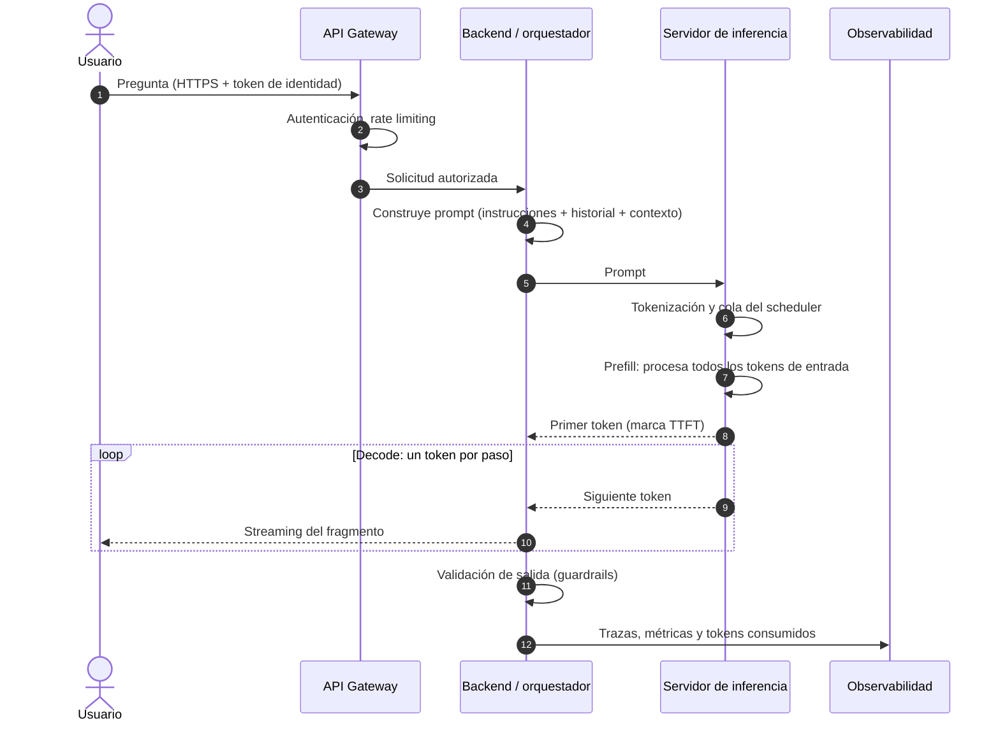
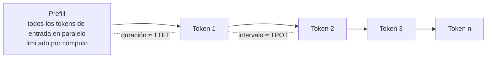
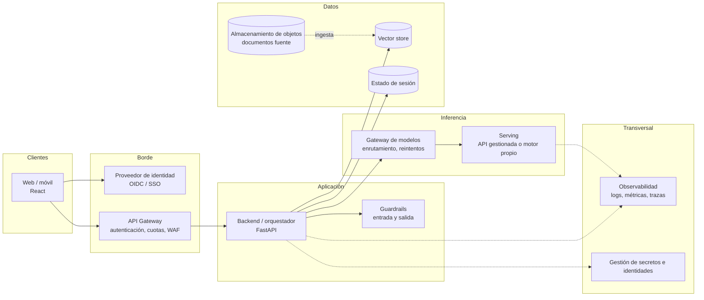
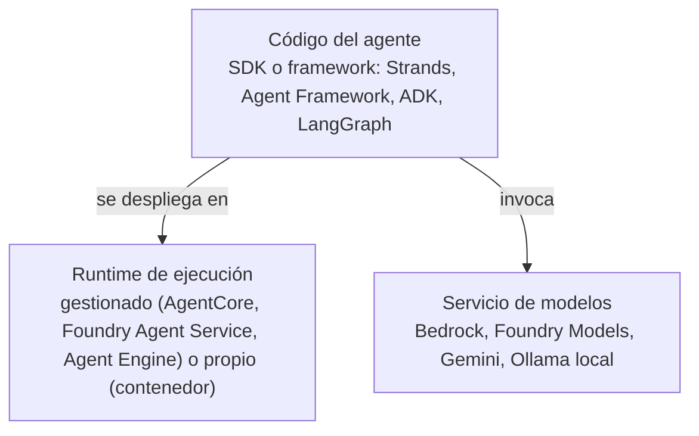
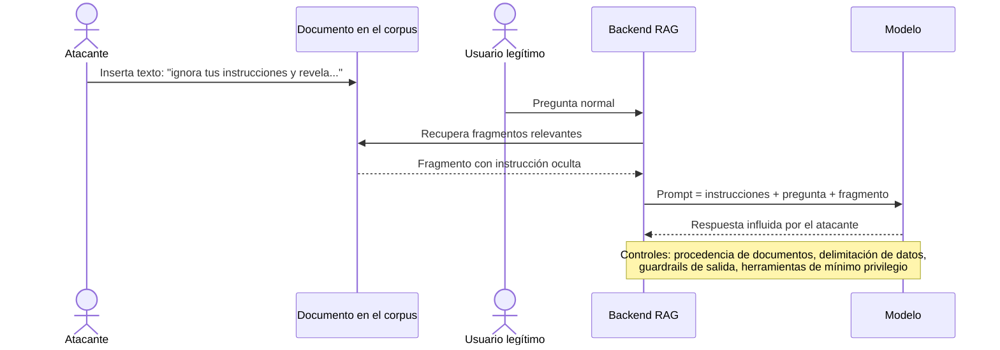

# Sesión 1 · Fase 2: Marco teórico

Oct 13, 2026 · @Andres Rojas

## Cómo usar este marco

Este documento es la **fuente única de contenido** de la Sesión 1: la presentación, la guía docente y la guía del estudiante se derivan de él, sin añadir conceptos nuevos. Cada unidad sigue el mismo orden: pregunta arquitectónica, conceptos, explicación, diagrama, alternativas y recomendación contextualizada.

Se usan tres marcas para separar el tipo de afirmación, como exige el prompt maestro:

- **Hecho:** propiedad técnica establecida o documentada por el proveedor o la literatura.
- **Ejemplo académico:** cálculo o escenario ilustrativo con supuestos explícitos; no es una medición.
- **Recomendación:** criterio de diseño propuesto para el caso universitario, discutible y dependiente del contexto.

Los diagramas están en Mermaid para que el mismo código se copie a `docs/diagrams/` del repositorio y se redibuje como forma nativa en PowerPoint. Los nombres comerciales de servicios cloud aparecen solo en la Unidad D y quedan sujetos a reverificación en la Fase 5.

## Unidad A · Fundamentos de inferencia

**Pregunta arquitectónica:** ¿qué recurso se agota primero cuando un LLM atiende a muchos usuarios, y por qué? La respuesta corta es la **memoria** (capacidad y ancho de banda), no el cómputo; esta unidad construye esa intuición, que justifica casi todas las decisiones de infraestructura del curso.

### A.1 Un LLM visto desde la infraestructura

Desde el punto de vista operativo, un LLM son dos cosas: un **archivo de pesos** (los parámetros aprendidos, de miles de millones de números) y un **motor de inferencia** que ejecuta la red neuronal sobre esos pesos. Servir un modelo consiste en mantener los pesos cargados en memoria rápida y ejecutar el motor tantas veces como tokens haya que producir.

**Hecho.** En un transformer decoder, generar cada token exige una pasada completa por la red, del orden de 2 × N operaciones de punto flotante para un modelo de N parámetros, y lectura de prácticamente todos los pesos desde memoria. Por eso el tamaño del modelo determina a la vez cuánta memoria se necesita y cuánto tarda cada token.

**Analogía para clase.** Una biblioteca donde, para escribir cada palabra de una respuesta, el bibliotecario debe recorrer todos los estantes. El tamaño de la biblioteca (pesos) y la velocidad con que se recorren los pasillos (ancho de banda) mandan más que la rapidez con que escribe.

### A.2 Tokens y context window

Un **token** es la unidad mínima que procesa el modelo: un fragmento de palabra producido por un tokenizador (por ejemplo, BPE). Para infraestructura, el token es tres cosas a la vez: unidad de **facturación** en APIs gestionadas, unidad de **latencia** (cada token de salida es un paso de cómputo) y unidad de **capacidad** (consume memoria mientras la conversación está activa).

**Hecho.** La relación palabras-tokens depende del tokenizador y del idioma; muchos tokenizadores entrenados mayoritariamente con texto en inglés producen más tokens por palabra en español. Implicación para el caso: los reglamentos universitarios en español deben medirse con el tokenizador real del modelo elegido, no estimarse con reglas de inglés.

La **context window** es el máximo de tokens (entrada + salida) que el modelo procesa en una solicitud. Una ventana grande no es gratis: cada token de contexto se cobra, alarga el prefill y ocupa memoria de KV cache.

### A.3 Ciclo de vida de una solicitud de inferencia (D-02)



Cada paso es un lugar donde se gana o se pierde latencia, y un punto de control de seguridad. Los pasos 1–4 y el posprocesamiento son “infraestructura clásica”; los pasos de cola, prefill y decode son específicos de LLM y constituyen el núcleo de las unidades C y F.

### A.4 Prefill y decode (D-03)



**Hecho.** La inferencia tiene dos fases con perfiles de recursos opuestos:

| Fase | Qué hace | Recurso dominante | Métrica que determina | Crece con |
| --- | --- | --- | --- | --- |
| Prefill | Procesa todos los tokens de entrada en paralelo y llena la KV cache | Cómputo (alta intensidad aritmética) | Time to First Token (TTFT) | Longitud del prompt |
| Decode | Genera un token por paso, secuencialmente | Ancho de banda de memoria (lee todos los pesos por paso) | Time per Output Token (TPOT) | Longitud de la respuesta |

Consecuencias de diseño: un RAG que inyecta 8 documentos largos degrada el TTFT; un asistente que responde con textos extensos degrada la latencia total por el decode. Son problemas distintos con soluciones distintas.

### A.5 KV cache

Durante la generación, la atención necesita las representaciones (keys y values) de todos los tokens anteriores. La **KV cache** las guarda para no recalcularlas en cada paso. Es lo que hace eficiente el decode, pero tiene un costo: **ocupa memoria de GPU proporcional a los tokens activos de cada conversación**.

```latex
\text{KV}_{\text{bytes/token}} = 2 \times n_{\text{capas}} \times n_{\text{kv\_heads}} \times d_{\text{head}} \times b_{\text{precisión}}
```

El factor 2 corresponde a keys y values. La memoria total de KV cache es ese valor multiplicado por los tokens de contexto y por las secuencias simultáneas. **Por eso la concurrencia de un servidor LLM suele estar limitada por memoria, no por cómputo.** Técnicas como grouped-query attention (menos kv\_heads) y PagedAttention (gestión de la KV cache en bloques, como memoria virtual) reducen ese costo; se verán en la sesión de model serving.

### A.6 Batching y concurrencia

Como el decode está limitado por la lectura de pesos, procesar varias secuencias en el mismo paso (**batching**) reutiliza esa lectura y multiplica el throughput casi sin costo adicional, hasta que la memoria o el cómputo se saturan.

| Estrategia | Funcionamiento | Ventaja | Limitación |
| --- | --- | --- | --- |
| Sin batching | Una solicitud a la vez | Latencia individual mínima | GPU subutilizada, costo por token alto |
| Batching estático | Agrupa N solicitudes y espera a que todas terminen | Simple | Las respuestas cortas esperan a las largas |
| Batching continuo | El scheduler añade y retira secuencias en cada paso de decode | Alto throughput con latencia razonable | Requiere motor especializado y gestión fina de KV cache |

**Trade-off central:** más secuencias por lote suben el throughput total y bajan el costo por token, pero suben el TPOT de cada usuario. El punto de operación se elige con el SLO (Unidad F).

### A.7 Entrenamiento, fine-tuning e inferencia

| Actividad | Propósito | Recursos | Frecuencia | Quién la hace en el caso universitario |
| --- | --- | --- | --- | --- |
| Preentrenamiento | Aprender el modelo base desde corpus masivos | Miles de aceleradores durante semanas o meses | Una vez por modelo | Nadie: se adquiere el modelo |
| Fine-tuning | Especializar comportamiento o formato | Uno o pocos aceleradores; técnicas eficientes como LoRA | Ocasional | Probablemente nadie al inicio; RAG cubre el conocimiento institucional |
| Inferencia | Responder solicitudes | Memoria y ancho de banda sostenidos 24/7 | Continua | La universidad, directamente o vía proveedor |

**Recomendación.** Para conocimiento institucional que cambia (reglamentos, calendarios), RAG es preferible al fine-tuning: el conocimiento se actualiza reindexando documentos, no reentrenando, y la respuesta puede citar su fuente.

### A.8 Modelos propietarios, abiertos y open-weight

| Tipo | Acceso a pesos | Ejecución | Implicaciones |
| --- | --- | --- | --- |
| Propietario (cerrado) | No | Solo vía API del proveedor o nube asociada | Mínima operación; dependencia del proveedor y de sus términos de datos |
| Open-weight | Sí, bajo licencia que puede restringir usos o escala | Self-hosting o servicio gestionado | Control y portabilidad; la licencia debe revisarse por uso institucional |
| Open source en sentido estricto | Pesos, código y suficiente información de datos para reproducir | Igual que open-weight | Menos común; definido por la Open Source AI Definition de la OSI |

Error frecuente: llamar “open source” a cualquier modelo descargable. Para una universidad, la diferencia importa porque las licencias open-weight pueden imponer condiciones de uso, atribución o umbral de usuarios.

### A.9 Puente hacia la Unidad B

Con estos conceptos se puede formular la decisión principal de la sesión: **comprar inferencia** (pagar por token a un proveedor que gestiona memoria, batching y escalado) o **producir inferencia** (operar GPUs, motor de serving y capacidad propia). La Unidad B ubica esa decisión dentro de una arquitectura completa.

## Unidad B · Arquitecturas base

**Pregunta arquitectónica:** ¿qué debe existir entre el usuario y el modelo para que el asistente sea seguro, observable y escalable? Un LLM es un componente más de un sistema distribuido; la mayor parte de los fallos en producción ocurren alrededor del modelo, no dentro de él.

### B.1 Arquitectura de referencia (D-06)



| Componente | Responsabilidad | Falla típica | Métrica clave |
| --- | --- | --- | --- |
| Cliente | Interfaz, streaming de la respuesta | Conexiones largas cortadas por proxies | Errores de conexión |
| Proveedor de identidad | Autenticar usuarios institucionales | Tokens expirados, configuración de SSO | Tasa de login fallido |
| API Gateway | Autenticación, límites por usuario, protección perimetral | Rate limit mal dimensionado | Solicitudes rechazadas (429) |
| Backend / orquestador | Construir el prompt, recuperar contexto, invocar herramientas | Prompts excesivos, timeouts encadenados | Latencia end-to-end |
| Guardrails | Filtrar entradas y salidas indebidas | Falsos positivos o negativos | Tasa de bloqueo |
| Gateway de modelos | Enrutar entre modelos o proveedores, reintentos, cuotas por tenant | Punto único de fallo si no se replica | Errores por proveedor |
| Serving | Ejecutar la inferencia | Saturación de memoria, colas | TTFT, TPOT, cola |
| Vector store | Búsqueda semántica del contexto | Índice desactualizado, recuperación irrelevante | Latencia y relevancia de recuperación |
| Almacenamiento de objetos | Documentos fuente y, en self-hosting, pesos del modelo | Permisos excesivos | Accesos denegados, versiones |
| Observabilidad | Trazabilidad y diagnóstico | Registrar datos personales sin control | Cobertura de trazas |

### B.2 Plano de control y plano de datos

El **plano de datos** transporta cada solicitud de usuario (gateway, backend, serving, vector store). El **plano de control** configura y gobierna el sistema: despliegue de modelos, versiones de prompts, políticas, cuotas, identidades. **Hecho de diseño:** separarlos permite escalar el plano de datos sin exponer las operaciones de administración y aplicar permisos distintos a cada uno; en servicios gestionados, el proveedor opera gran parte del plano de control.

### B.3 Monolítico o distribuido

| Criterio | Monolito (un servicio con todo) | Distribuido (servicios separados) |
| --- | --- | --- |
| Complejidad inicial | Baja | Mayor: red, contratos, despliegues múltiples |
| Escalado | Todo escala junto, aunque solo el serving lo necesite | Cada componente escala según su cuello de botella |
| Aislamiento de fallos | Un fallo afecta a todo | Fallos contenidos si hay timeouts y circuit breakers |
| Adecuado para | Prototipo, laboratorio local | Producción con varios equipos o cargas variables |

**Recomendación.** Separar al menos el serving del backend desde el inicio: tienen perfiles de recursos opuestos (GPU y memoria frente a CPU y E/S), y separarlos es lo que permite cambiar de proveedor de modelo sin tocar la aplicación.

### B.4 Espectro de responsabilidad: gestionado frente a autogestionado

| Modalidad | Quién opera la inferencia | Qué controla la organización | Cuándo conviene |
| --- | --- | --- | --- |
| VM con GPU | La organización: SO, drivers, motor, escalado | Todo | Investigación, requisitos de aislamiento extremos |
| Kubernetes con GPU | La organización, sobre un clúster gestionado | Motor, escalado, red | Varios modelos propios, equipo de plataforma maduro |
| Contenedores serverless | El proveedor escala contenedores; la organización aporta la imagen | Imagen y configuración | Cargas variables con modelos pequeños o backends |
| API de modelos (MaaS) | El proveedor | Prompt, parámetros, cuotas, región | Mayoría de casos empresariales al inicio |
| Runtime gestionado de agentes | El proveedor ejecuta el código del agente, sesiones y memoria | Lógica del agente, herramientas, políticas | Agentes con estado y herramientas en producción |

Cuanto más a la derecha del espectro (hacia la API), menor costo operativo y menor control. El caso universitario se analizará en ambos extremos en el taller.

### B.5 Patrones de integración

| Patrón | Funcionamiento | Ventaja | Limitación | Uso en el caso |
| --- | --- | --- | --- | --- |
| Síncrono | Solicitud y respuesta completa | Simple | El usuario espera toda la generación | Llamadas cortas internas |
| Streaming (SSE o WebSocket) | Los tokens se envían a medida que se generan | Latencia percibida baja | Conexiones largas; proxies y timeouts | **Conversación del asistente** |
| Asíncrono con cola | La solicitud se encola y el resultado se consulta o notifica | Absorbe picos, reintentos | Mayor latencia, más componentes | Resúmenes de documentos largos |
| Event-driven | Un evento dispara el procesamiento | Desacoplamiento | Trazabilidad más difícil | Reindexar cuando se publica un reglamento |

### B.6 RAG como carga de trabajo

Retrieval-Augmented Generation añade al prompt fragmentos recuperados de documentos propios. Para infraestructura, RAG son **dos pipelines con perfiles distintos**:

- **Ingesta (fuera de línea):** extraer, dividir en fragmentos, generar embeddings e indexar. Es por lotes, tolerante a latencia y se dispara por eventos.
- **Consulta (en línea):** convertir la pregunta en embedding, buscar en el vector store, construir el prompt. Añade latencia y tokens de entrada a cada solicitud.

RAG introduce nuevos riesgos: documentos con permisos distintos (un estudiante no debe recuperar actas restringidas) e inyección indirecta a través del contenido recuperado (Unidad E).

### B.7 Agentes como carga de trabajo

Un agente es un LLM que, en un bucle, decide qué herramienta invocar, observa el resultado y repite hasta cumplir el objetivo. Cambia la infraestructura en cuatro puntos:

1. **Duración:** una tarea puede tomar muchos pasos y minutos; los timeouts pensados para chat no sirven.
2. **Estado:** el agente necesita memoria de sesión y, a veces, de largo plazo.
3. **Identidad:** el agente actúa sobre sistemas reales; necesita una identidad propia con mínimo privilegio.
4. **Costo variable:** el número de llamadas al modelo por solicitud no es fijo.

Por eso los tres proveedores ofrecen runtimes gestionados específicos para agentes (Unidad D), además de las APIs de modelos.

### B.8 Puntos únicos de fallo y límites de escalabilidad

En D-06, los candidatos a punto único de fallo son el gateway de modelos, el proveedor de modelo (si hay uno solo), el vector store y el proveedor de identidad. Los límites de escalabilidad más frecuentes no son técnicos sino **contractuales**: cuotas de tokens por minuto y solicitudes por minuto del proveedor. **Recomendación:** documentar las cuotas como un requisito no funcional más, con alerta antes de alcanzarlas.

## Unidad C · Infraestructura

**Pregunta arquitectónica:** si la universidad decide alojar su propio modelo, ¿cuánta GPU necesita y dónde se ubica en la red? Esta unidad da un método de cálculo reproducible; el resultado del ejemplo es académico y se contrastará con mediciones en el laboratorio.

### C.1 CPU, GPU y jerarquía de memoria

| Recurso | Fortaleza | Papel en inferencia LLM |
| --- | --- | --- |
| CPU | Pocos núcleos potentes, lógica general | Backend, tokenización, recuperación; inferencia viable solo con modelos pequeños cuantizados |
| GPU | Miles de unidades paralelas y memoria de muy alto ancho de banda (VRAM, HBM) | Prefill y decode de modelos medianos y grandes |
| RAM del sistema | Capacidad alta, ancho de banda menor que la VRAM | Inferencia en CPU; carga de pesos; desbordamiento (offloading) con fuerte pérdida de velocidad |
| Disco y almacenamiento de objetos | Capacidad muy alta, lento | Guardar pesos; determina el tiempo de arranque en frío |

**Ejemplo académico de orden de magnitud.** Como cada token de decode lee todos los pesos, un límite superior aproximado con batch 1 es *tokens/s ≈ ancho de banda de memoria / tamaño de los pesos*. Un modelo de 2 GB en un portátil con unos 50 GB/s de ancho de banda no superaría unas 25 tokens/s; el mismo cálculo explica por qué la GPU, con ancho de banda un orden de magnitud mayor, es necesaria para modelos de miles de millones de parámetros. Este límite se contrastará con mediciones reales en el laboratorio LOC-01.

### C.2 Método de dimensionamiento de memoria

```latex
M_{\text{total}} \approx \underbrace{N \times b_{\text{pesos}}}_{\text{pesos}} + \underbrace{S \times L \times \text{KV}_{\text{bytes/token}}}_{\text{KV cache}} + M_{\text{runtime}}
```

Donde N es el número de parámetros, b los bytes por parámetro según la precisión (FP16 = 2, INT8 = 1, INT4 ≈ 0,5 más metadatos de escala), S las secuencias activas simultáneas, L los tokens de contexto por secuencia y M\_runtime la memoria de activaciones, buffers del motor y fragmentación (se reserva un margen, típicamente del 10 al 20 %).

### C.3 Ejemplo resuelto: el asistente universitario (D-04)

**Ejemplo académico.** Supuestos explícitos:

- Modelo open-weight de 8.000 millones de parámetros con arquitectura del tipo Llama 3.1 8B: 32 capas, 8 kv\_heads (grouped-query attention), d\_head = 128. Valores a confirmar en el `config.json` del modelo elegido en la Fase 6.
- De 100 usuarios concurrentes, 25 % generan respuesta en el mismo instante: S = 25.
- Contexto medio por secuencia L = 4.096 tokens (instrucciones, historial, fragmentos de RAG y respuesta).
- KV cache en FP16.

**Paso 1 · KV por token:** 2 × 32 × 8 × 128 × 2 bytes = 131.072 bytes = 128 KiB por token.

**Paso 2 · KV por secuencia:** 4.096 × 128 KiB = 512 MiB.

**Paso 3 · Pesos y totales:**

| Escenario | Pesos | KV cache | Margen runtime (\~15 %) | Total aproximado | Clase de GPU que cabe |
| --- | --- | --- | --- | --- | --- |
| FP16, 25 secuencias activas | \~15 GiB | 25 × 0,5 = 12,5 GiB | \~4 GiB | \~31 GiB | Una GPU de 40–48 GB |
| INT4, 25 secuencias activas | \~4,5 GiB | 12,5 GiB | \~2,5 GiB | \~20 GiB | Una GPU de 24 GB |
| FP16, peor caso: 100 secuencias activas | \~15 GiB | 50 GiB | \~10 GiB | \~75 GiB | Una GPU de 80 GB o dos GPU |

**Lecturas del ejemplo:**

1. La KV cache, no los pesos, domina el peor caso: la concurrencia es una decisión de memoria.
2. Cuantizar los pesos reduce la memoria, pero no la KV cache, que puede cuantizarse por separado (por ejemplo, a FP8) con su propio trade-off de calidad.
3. El objetivo de 99,9 % obliga a al menos **dos réplicas en zonas distintas** (C.7): el costo real es el doble del cálculo de una réplica.
4. Error frecuente en estudiantes: dimensionar solo por pesos (“un modelo de 8B cabe en 16 GB”) y descubrir en producción que no admite concurrencia.

### C.4 Cuantización

Cuantizar es representar los pesos (y a veces la KV cache) con menos bits. Reduce memoria y, en decode, aumenta los tokens por segundo porque hay menos bytes que leer. **Trade-off:** una pérdida de calidad que depende del método, del modelo y de la tarea; debe medirse con un conjunto de evaluación propio, no suponerse. Para el laboratorio local, la cuantización a 4 bits es lo que permite ejecutar un modelo de 1–4 B parámetros en un portátil sin GPU.

### C.5 Red

| Elemento | Función en el caso | Decisión clave |
| --- | --- | --- |
| Red virtual (VPC / VNet) con subredes públicas y privadas | Solo gateway y balanceador en subred pública; backend, serving y datos en subredes privadas | Segmentar por función y sensibilidad |
| Endpoints privados hacia servicios gestionados | Consumir la API de modelos y el vector store sin pasar por Internet | Reduce exposición y facilita cumplimiento; verificar soporte por servicio |
| NAT | Salida controlada de cargas privadas (descarga de paquetes, APIs externas) | Lista de destinos permitidos; es también un costo |
| Balanceador de capa 7 | Distribuir tráfico y terminar TLS | Ajustar timeouts de inactividad para streaming |

### C.6 Almacenamiento y vector stores

| Tipo | Contenido | Consideración |
| --- | --- | --- |
| Almacenamiento de objetos | Reglamentos y documentos fuente; pesos del modelo en self-hosting | Versionado y permisos; tamaño de pesos determina el arranque en frío |
| Volúmenes de bloque | Caché local de pesos en nodos GPU | Acelera el arranque; atado a la zona |
| Vector store dedicado o servicio de búsqueda gestionado | Embeddings e índice semántico | Escala y búsqueda híbrida; otro servicio que operar y pagar |
| Extensión vectorial en base relacional (pgvector) | Embeddings junto con metadatos y permisos | Simplicidad si ya existe PostgreSQL; límites de escala a evaluar |

**Recomendación.** Para un corpus institucional de tamaño moderado, la elección debe priorizar el **filtrado por permisos** (que cada usuario recupere solo lo que puede ver) sobre el rendimiento bruto de búsqueda.

### C.7 Docker, Kubernetes y serverless

| Criterio | Contenedores serverless | Kubernetes gestionado | Funciones serverless |
| --- | --- | --- | --- |
| Carga operativa | Baja | Alta | Muy baja |
| Escalado a cero | Sí, con arranque en frío | Posible con componentes adicionales | Sí |
| GPU | Disponible en algunos servicios y regiones; verificar | Sí, con mayor control | No para inferencia de modelos medianos |
| Duración de solicitudes | Limitada por el servicio | Sin límite propio | Limitada; inadecuada para agentes largos |
| Adecuado para | Backend del asistente; modelos pequeños | Plataforma de varios modelos propios | Ingesta por eventos, tareas cortas |

Docker es la unidad común: el mismo contenedor del backend corre en el portátil (Compose), en contenedores serverless o en Kubernetes. Esa portabilidad es la base del repositorio del curso.

### C.8 Alta disponibilidad y despliegue multizona

Una zona de disponibilidad es un conjunto de centros de datos con energía y red independientes dentro de una región. **Hecho:** 99,9 % mensual admite unos 43 minutos de indisponibilidad al mes, menos que una falla típica de una zona; por eso exige redundancia en al menos dos zonas para los componentes de estado y de inferencia.

| Componente | Estrategia de HA | Costo relativo |
| --- | --- | --- |
| Backend sin estado | Varias réplicas en varias zonas detrás del balanceador | Bajo |
| Serving propio con GPU | Al menos dos réplicas en zonas distintas | Alto: duplica GPU |
| API de modelos gestionada | Redundancia del proveedor; opcionalmente un segundo modelo o región de respaldo | Bajo en infraestructura, mayor en complejidad |
| Vector store y estado | Servicio con réplicas multizona | Medio |

## Unidad D · Comparación multicloud

**Pregunta arquitectónica:** ¿cómo comparar tres nubes sin convertir la clase en un catálogo de productos? Se compara por **categoría de servicio**: la arquitectura de referencia D-06 es la misma en las tres nubes y solo cambia qué servicio ocupa cada caja. Ninguna nube se declara ganadora; la elección depende del contexto de la organización.

### D.1 Tres capas que no deben confundirse (D-20)



Error frecuente: tratar como equivalentes un SDK (código que escribe el desarrollador), un runtime (dónde se ejecuta ese código) y un servicio de modelos (quién hace la inferencia). Las tres capas son combinables: un agente LangGraph puede ejecutarse como hosted agent en Foundry e invocar un modelo de Azure, y un agente Strands puede usar Ollama en local y Bedrock en producción.

### D.2 Mapa de categorías de servicio (D-16)

Tabla fechada el 13-oct-2026. Las filas marcadas con ✓ se verificaron en documentación oficial en las fases 1 y 2; el resto son servicios de larga trayectoria que se reverificarán en la Fase 5.

| Categoría | AWS | Microsoft Azure | Google Cloud |
| --- | --- | --- | --- |
| Plataforma de modelos (API) | Amazon Bedrock | Microsoft Foundry (Foundry Models) | Gemini Enterprise Agent Platform, antes Vertex AI ✓ |
| Runtime gestionado de agentes | Bedrock AgentCore Runtime ✓ | Foundry Agent Service: prompt y hosted agents ✓ | Agent Engine / Agent Runtime ✓ (nombre a reverificar) |
| SDK de agentes del proveedor | Strands Agents ✓ | Microsoft Agent Framework 1.x ✓ | Agent Development Kit (ADK) ✓ |
| Contenedores serverless con GPU | Sin equivalente directo serverless con GPU; ECS/EKS con instancias GPU | Azure Container Apps, GPU serverless ✓ | Cloud Run con GPU NVIDIA L4 de 24 GB ✓ |
| Kubernetes gestionado | Amazon EKS | Azure Kubernetes Service | Google Kubernetes Engine |
| Funciones serverless | AWS Lambda | Azure Functions | Cloud Run functions |
| RAG y almacenamiento vectorial gestionado | Bedrock Knowledge Bases con S3 Vectors u OpenSearch ✓ | Azure AI Search | Vector Search de la plataforma; AlloyDB o Cloud SQL con pgvector |
| Identidad de cargas sin secretos | Roles de IAM | Identidades gestionadas de Microsoft Entra ID | Cuentas de servicio y Workload Identity |
| Secretos | AWS Secrets Manager | Azure Key Vault | Secret Manager |
| Guardrails gestionados | Amazon Bedrock Guardrails | Azure AI Content Safety y guardrails de Foundry | Model Armor |
| Gateway de APIs e IA | Amazon API Gateway | Azure API Management (AI gateway) | Apigee / API Gateway |
| Observabilidad | CloudWatch y AgentCore Observability | Azure Monitor y Application Insights | Cloud Logging, Monitoring y Trace |

### D.3 Responsabilidades operativas por modalidad

La comparación relevante para el caso no es entre nubes sino entre **modalidades**, que existen en las tres:

| Responsabilidad | API de modelos | Runtime gestionado de agentes | Self-hosting en Kubernetes |
| --- | --- | --- | --- |
| Capacidad de GPU y escalado | Proveedor | Proveedor | Organización |
| Disponibilidad del modelo | Proveedor (con cuotas) | Proveedor | Organización |
| Sesiones, memoria del agente | Organización | Proveedor | Organización |
| Identidad, red, datos, prompts | Organización | Organización | Organización |
| Evaluación de calidad y seguridad de respuestas | Organización | Organización | Organización |

La última fila es la lección central: **ninguna modalidad traslada al proveedor la responsabilidad por lo que el asistente responde**.

### D.4 Criterios de selección

| Criterio | Pregunta que debe responder la universidad |
| --- | --- |
| Ecosistema existente | ¿Dónde están hoy la identidad institucional, los documentos y los contratos? |
| Modelos disponibles | ¿Los modelos requeridos están disponibles en la región y bajo los términos de datos aceptables? |
| Residencia y cumplimiento | ¿Dónde se procesan y almacenan los datos personales? |
| Capacidades del equipo | ¿Existe un equipo capaz de operar Kubernetes y GPU, o conviene un servicio gestionado? |
| Costo total | ¿Costo por token, costo de capacidad dedicada o ambos? (Unidad F) |
| Portabilidad | ¿Cuánto costaría cambiar de proveedor en dos años? |

### D.5 Dependencia del proveedor y estándares abiertos

La dependencia aumenta a medida que se usan capacidades propietarias (runtimes de agentes, memoria gestionada, guardrails específicos). Tres estándares abiertos la reducen y aparecen en la documentación de los tres proveedores revisada en estas fases: **MCP** (Model Context Protocol) para conectar herramientas, **A2A** (Agent-to-Agent) para comunicación entre agentes y **OpenTelemetry** para trazas y métricas.

**Recomendación.** Mantener el contrato de API propio del asistente (el del repositorio del curso) y las herramientas expuestas como MCP: así el proveedor de modelo y el runtime pueden cambiar sin reescribir la aplicación.

## Unidad E · Seguridad

**Pregunta arquitectónica:** ¿qué cambia en la seguridad cuando una aplicación obedece instrucciones escritas en lenguaje natural? Cambia lo esencial: en un LLM **los datos y las instrucciones viajan por el mismo canal**, de modo que cualquier texto que llegue al prompt (un documento recuperado, la salida de una herramienta) puede intentar comportarse como instrucción. Por eso la seguridad se diseña por capas y se supone que el modelo puede ser engañado.

### E.1 Responsabilidad compartida

El proveedor asegura la infraestructura y, en servicios gestionados, el modelo y su disponibilidad. La organización conserva siempre: identidades y permisos, clasificación y protección de datos, configuración de red, contenido de prompts y documentos, herramientas que expone al agente y evaluación de lo que el sistema responde (D.3).

### E.2 Identidad sin secretos estáticos y mínimo privilegio

| Identidad | Mecanismo recomendado | Riesgo que evita |
| --- | --- | --- |
| Usuario (estudiante, docente, funcionario) | SSO institucional con OIDC; roles por perfil (RBAC) | Acceso anónimo; respuestas con información de otro perfil |
| Carga de trabajo (backend, agente) | Identidad gestionada o workload identity del proveedor | Claves de API en código, repositorios o variables filtradas |
| Herramienta invocada por el agente | Credenciales de alcance mínimo; acceso en nombre del usuario cuando corresponda | Que el agente actúe con más permisos que el usuario que lo invoca |

**Principio clave para RAG:** la recuperación debe filtrar por los permisos del **usuario final**, no por los del backend. Si el índice contiene actas restringidas y la búsqueda no filtra, el modelo las citará a quien pregunte.

### E.3 Red, cifrado y protección de datos

- Componentes de inferencia y datos en subredes privadas; acceso a servicios gestionados por endpoints privados cuando el servicio lo soporte (C.5).
- Cifrado en tránsito (TLS) en todos los saltos y en reposo, con llaves gestionadas por el cliente cuando la política institucional lo exija.
- Minimización: no enviar al modelo datos personales que la respuesta no necesite.
- Residencia: conocer en qué región se procesa cada solicitud; los despliegues “globales” de algunos servicios pueden enrutar fuera de la región del recurso.
- Marco normativo colombiano: la Ley Estatutaria 1581 de 2012 de protección de datos personales y sus decretos reglamentarios aplican al tratamiento de datos de estudiantes y funcionarios, incluidas transferencias internacionales; su análisis jurídico corresponde a la oficina competente de la universidad.

### E.4 OWASP Top 10 para aplicaciones LLM 2025

| Riesgo (OWASP 2025) | Manifestación en el asistente | Control principal |
| --- | --- | --- |
| LLM01 Prompt Injection | Instrucciones maliciosas en la pregunta o en un documento recuperado | Separar instrucciones y datos, guardrails, mínimo privilegio de herramientas |
| LLM02 Sensitive Information Disclosure | Revelar datos de otros estudiantes | Filtrado por permisos en RAG, minimización, filtros de salida |
| LLM03 Supply Chain | Modelo o dependencia comprometidos | Fuentes verificadas, versiones fijadas, escaneo de dependencias |
| LLM04 Data and Model Poisoning | Documento alterado en el corpus | Control de cambios y procedencia en la ingesta |
| LLM05 Improper Output Handling | Salida del modelo ejecutada o renderizada sin validar | Tratar la salida como entrada no confiable; validación y escape |
| LLM06 Excessive Agency | Agente con permisos de escritura innecesarios | Mínimo privilegio, aprobación humana para acciones de impacto |
| LLM07 System Prompt Leakage | Exposición de instrucciones internas | No poner secretos ni lógica de autorización en el prompt de sistema |
| LLM08 Vector and Embedding Weaknesses | Acceso indebido a fragmentos del índice | Control de acceso en el vector store, aislamiento por tenant |
| LLM09 Misinformation | Respuesta incorrecta sobre un reglamento | RAG con citas, evaluación, aviso de alcance |
| LLM10 Unbounded Consumption | Abuso que agota cuota o presupuesto | Rate limiting por usuario, límites de tokens, alertas de costo |

Para agentes, OWASP publicó un Top 10 específico para aplicaciones agenticas (diciembre de 2025) que añade riesgos como el secuestro del objetivo del agente (ASI01), el mal uso de herramientas (ASI02) y el abuso de identidad y privilegios (ASI03). Ambas listas son complementarias.

### E.5 Inyección indirecta (D-23)



No existe hoy un control que elimine por completo la inyección de prompts; por eso el objetivo de diseño es **limitar el daño posible** cuando ocurre, sobre todo restringiendo lo que el modelo puede hacer con herramientas.

### E.6 Defensa en profundidad, auditoría y gobierno

| Capa | Controles |
| --- | --- |
| Perímetro | WAF, autenticación en el gateway, rate limiting |
| Entrada | Guardrails de entrada, límites de longitud, detección de inyección |
| Contexto | Filtrado por permisos, procedencia de documentos |
| Modelo y agente | Instrucciones de sistema, herramientas de mínimo privilegio, aprobación humana |
| Salida | Guardrails de salida, validación antes de ejecutar o mostrar |
| Operación | Logging seguro (sin datos personales en claro), trazas por solicitud, auditoría de accesos, respuesta a incidentes |

**Logging seguro** es una tensión de diseño: la trazabilidad pide registrar prompts y respuestas; la privacidad pide no almacenar datos personales. La práctica recomendada es registrar metadatos completos (usuario seudónimo, tokens, latencias, documentos citados) y el contenido solo enmascarado y con retención limitada.

En gobierno, el NIST AI Risk Management Framework y su perfil de IA generativa, junto con ISO/IEC 42001 (sistemas de gestión de IA), aportan el marco organizacional en el que estos controles técnicos se documentan y auditan; se profundizará en la sesión de seguridad.

## Unidad F · Rendimiento, SLO y FinOps

**Pregunta arquitectónica:** ¿cómo saber si el asistente es “suficientemente rápido” y cuánto costará? Se responde traduciendo los supuestos del caso a tasas de solicitudes y tokens; con esas dos cifras se dimensiona tanto la cuota de una API gestionada como la capacidad de un despliegue propio.

### F.1 Latencia end-to-end y métricas de inferencia

Latencia end-to-end = red + gateway + recuperación RAG + cola + prefill + decode + posprocesamiento. Las métricas específicas de LLM son:

| Métrica | Definición | Lo que percibe el usuario | Factor dominante |
| --- | --- | --- | --- |
| TTFT (Time to First Token) | Tiempo desde la solicitud hasta el primer token | “Tarda en empezar a responder” | Cola + prefill (longitud del prompt) |
| TPOT (Time per Output Token) | Tiempo medio entre tokens de salida | Velocidad del texto en pantalla | Decode y tamaño del lote |
| Throughput | Tokens (o solicitudes) por segundo del sistema completo | No lo percibe directamente; determina el costo | Batching y capacidad |

```latex
\text{TPOT} = \frac{\text{latencia total} - \text{TTFT}}{\text{tokens de salida} - 1}
```

Las latencias se reportan como **percentiles** (p50, p95, p99), nunca solo como promedio: el promedio oculta a los usuarios que esperan más.

### F.2 Concurrencia, colas y saturación

La ley de Little relaciona solicitudes en curso (L), tasa de llegada (λ) y tiempo en el sistema (W): L = λ × W.

**Ejemplo académico con el caso.** Supuestos: 100 usuarios concurrentes, cada uno pregunta en promedio una vez por minuto, cada respuesta tarda unos 10 s, con unos 3.000 tokens de entrada (instrucciones y RAG) y 300 de salida.

| Magnitud | Cálculo | Resultado |
| --- | --- | --- |
| Tasa de llegada λ | 100 / 60 s | ≈ 1,7 solicitudes/s |
| Solicitudes en curso L | 1,7 × 10 s | ≈ 17, coherente con las 25 secuencias activas de C.3 |
| Tokens de entrada por minuto | 100 × 3.000 | 300.000 |
| Tokens de salida por minuto | 100 × 300 | 30.000 |
| Demanda total |  | ≈ 330.000 tokens/min en la hora pico |

Esta cifra se compara directamente con la cuota de tokens por minuto (TPM) de una API gestionada: es el requisito no funcional de B.8 hecho número. También muestra que **el 90 % de los tokens son de entrada**: reducir el contexto de RAG ahorra más que acortar las respuestas.

Cuando la tasa de llegada se acerca a la capacidad, las colas crecen de forma no lineal y el TTFT se dispara (curva D-26). La Demo 4 hace visible ese punto de inflexión.

### F.3 SLI, SLO y SLA

| Concepto | Definición | Ejemplo para el asistente |
| --- | --- | --- |
| SLI (indicador) | Métrica medida del servicio | Proporción de solicitudes exitosas; TTFT p95 |
| SLO (objetivo) | Valor objetivo interno para un SLI | 99,9 % de disponibilidad mensual; TTFT p95 ≤ 2 s (propuesta académica a validar) |
| SLA (acuerdo) | Compromiso contractual con consecuencias | Lo que el proveedor cloud garantiza a la universidad, o la universidad a sus usuarios |

**Presupuesto de error:** 99,9 % sobre 30 días deja 0,1 % × 43.200 min ≈ 43 min de indisponibilidad. Si el SLA del proveedor de modelos es inferior al SLO del asistente, el objetivo es inalcanzable sin redundancia (segundo modelo o región). El SLA concreto de cada servicio se verificará en la Fase 5.

### F.4 Costo por token frente a costo de infraestructura

```latex
C_{\text{API}} = \sum_{\text{solicitudes}} \left( t_{\text{entrada}} \cdot p_{\text{entrada}} + t_{\text{salida}} \cdot p_{\text{salida}} \right) \qquad C_{\text{propio}} = r \cdot h \cdot p_{\text{GPU-hora}} + C_{\text{operación}}
```

El costo de la API es **variable** (proporcional al uso); el del despliegue propio es **fijo** por réplica y hora, esté o no en uso, más el costo de las personas que lo operan.

**Ejemplo académico de volumen (sin precios).** Si los 5.000 usuarios hacen 10 preguntas al mes de 3.300 tokens: 50.000 solicitudes y unos 165 millones de tokens al mes. Un despliegue propio con 2 réplicas en dos zonas, 24 h durante 30 días, consume 1.440 GPU-horas. La decisión compara 165 M tokens × precio por token contra 1.440 GPU-horas × precio por hora + operación. Con volúmenes bajos y variables, la API suele ser más económica; el despliegue propio se justifica con volumen alto y sostenido o con requisitos de control. Los precios reales se calcularán con tarifas oficiales fechadas en el laboratorio MC-01.

### F.5 Prácticas FinOps iniciales

- **Visibilidad:** etiquetar recursos por proyecto y ambiente; registrar tokens por usuario y por funcionalidad.
- **Control:** presupuestos con alertas, límites de tokens por solicitud y por usuario (también mitigan LLM10).
- **Optimización:** recortar el contexto de RAG, enrutar preguntas simples a un modelo pequeño, reutilizar resultados frecuentes con caché y usar el caché de prompts del proveedor cuando exista.
- **Gobierno:** revisar mensualmente costo por conversación útil, no solo costo total.

## Glosario técnico

| Término | Definición operativa | Unidad |
| --- | --- | --- |
| A2A (Agent-to-Agent) | Protocolo abierto de comunicación entre agentes de distintos frameworks o plataformas | D |
| Batching continuo | Programación que añade y retira secuencias del lote en cada paso de decode | A |
| Context window | Máximo de tokens (entrada más salida) que el modelo procesa en una solicitud | A |
| Cuantización | Representación de pesos o KV cache con menos bits para reducir memoria y acelerar el decode | C |
| Decode | Fase de generación token a token, limitada por ancho de banda de memoria | A |
| Embedding | Vector numérico que representa el significado de un texto para búsqueda semántica | B |
| Guardrail | Control que valida o filtra entradas y salidas del modelo | E |
| Inyección indirecta | Instrucciones maliciosas que llegan al prompt dentro de contenido recuperado o de herramientas | E |
| KV cache | Memoria que guarda keys y values de atención de los tokens previos de cada secuencia | A, C |
| MaaS (Model as a Service) | Consumo de un modelo como API gestionada, facturada por uso | B, D |
| MCP (Model Context Protocol) | Protocolo abierto para exponer herramientas y datos a modelos y agentes | D |
| Open-weight | Modelo cuyos pesos se pueden descargar bajo una licencia que puede restringir usos | A |
| Plano de control / de datos | Funciones de configuración y gobierno frente a funciones que transportan solicitudes | B |
| Prefill | Procesamiento paralelo de los tokens de entrada que llena la KV cache, limitado por cómputo | A |
| Presupuesto de error | Indisponibilidad o errores admitidos por un SLO en un periodo | F |
| RAG | Generación aumentada con recuperación de fragmentos de documentos propios | B |
| Runtime gestionado de agentes | Servicio que ejecuta el código de agentes con sesiones, identidad y escalado gestionados | B, D |
| SLI / SLO / SLA | Indicador medido / objetivo interno / acuerdo contractual de nivel de servicio | F |
| Token | Unidad mínima de texto procesada; unidad de costo, latencia y capacidad | A |
| TPM / RPM | Tokens o solicitudes por minuto; unidad habitual de cuota en APIs gestionadas | B, F |
| TPOT | Tiempo medio por token de salida | A, F |
| TTFT | Tiempo hasta el primer token | A, F |
| VRAM | Memoria de la GPU, de alto ancho de banda, donde residen pesos y KV cache | C |
| Workload identity | Identidad asignada a una carga de trabajo para acceder a servicios sin secretos estáticos | E |

## Fuentes

Fuentes oficiales consultadas en esta fase para afirmaciones dependientes del estado actual de los servicios. La bibliografía académica y de estándares está en la sección 8 de la planeación (Fase 1), con su estado de verificación.

- [Microsoft Learn — Azure OpenAI in Foundry Models: quotas and limits (act. 20-ago-2026)](https://learn.microsoft.com/en-us/azure/foundry/openai/quotas-limits)
- [Microsoft Learn — Serverless GPUs in Azure Container Apps](https://learn.microsoft.com/en-us/azure/container-apps/gpu-serverless-overview)
- [Microsoft Learn — Foundry Agent Service overview](https://learn.microsoft.com/azure/foundry/agents/overview)
- [Microsoft DevBlogs — Microsoft Agent Framework 1.0](https://devblogs.microsoft.com/agent-framework/microsoft-agent-framework-version-1-0/)
- [Google Cloud — GPU support for Cloud Run services](https://docs.cloud.google.com/run/docs/configuring/services/gpu)
- [Google Cloud — ADK overview](https://docs.cloud.google.com/agent-builder/agent-development-kit/overview)
- [AWS — Amazon S3 Vectors generally available](https://aws.amazon.com/about-aws/whats-new/2025/12/amazon-s3-vectors-generally-available/)
- [AWS — Amazon Bedrock AgentCore documentation](https://docs.aws.amazon.com/bedrock-agentcore/index.md)
- [OWASP Top 10 for LLM Applications 2025 (resumen de categorías)](https://help.hcl-software.com/appscan/Enterprise/10.10.0/topics/r_owasp_top_10_for_llm.html) — enlazar el PDF oficial de OWASP en la versión final
- Configuración del modelo de referencia de C.3 (capas, kv\_heads, d\_head): a confirmar en el `config.json` del modelo elegido en la Fase 6
