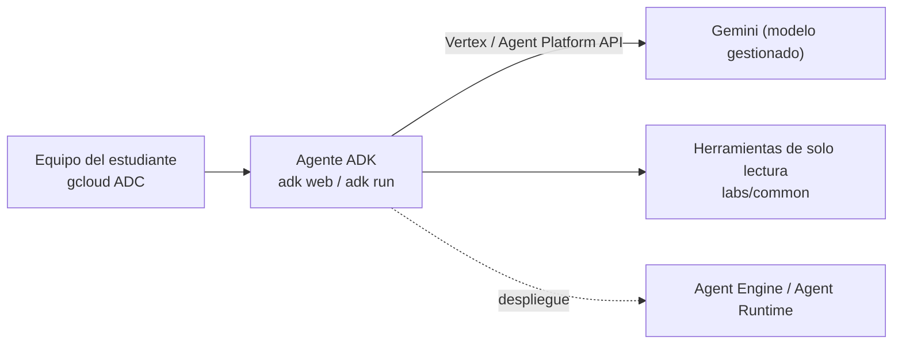

# Laboratorios Google Cloud (GCP-A a GCP-C)

> **Estado de validación (13-oct-2026):** el agente de GCP-B se construye correctamente con google-adk 2.12.0 (ver `labs/VALIDACION.md`), pero **no se ha ejecutado contra un proyecto real** ni contra Gemini. En abril de 2026 Vertex AI pasó a llamarse **Gemini Enterprise Agent Platform**; verifique los nombres de consola y del runtime de agentes (Agent Engine / Agent Runtime) antes de asignar los laboratorios.

| Lab | Tema | Duración |
| --- | --- | --- |
| GCP-A | Agente desde la consola (Agent Studio) | 60 min |
| GCP-B | Agente con ADK y Gemini, local y despliegue gestionado | 120 min |
| GCP-C | Arquitectura del caso y comparación gestionado vs. dedicado | 60 min |

## Arquitectura



## Restricciones de la cuenta trial (verificadas)

- US$300 por 90 días. Durante la trial no se pueden añadir GPU a VMs ni usar modelos de terceros como servicio.
- El crédito **no cubre la Gemini API de AI Studio**: estos laboratorios usan la plataforma con `GOOGLE_GENAI_USE_VERTEXAI=TRUE` y Application Default Credentials.

Fuente: <https://docs.cloud.google.com/free/docs/free-cloud-features>

## Preparación

```bash
gcloud projects create llm-curso-<usuario>
gcloud config set project llm-curso-<usuario>
gcloud billing projects link llm-curso-<usuario> --billing-account=<ID-cuenta-trial>
gcloud services enable aiplatform.googleapis.com
gcloud auth application-default login
```

Configure un presupuesto en Billing con alertas al 50 % y 90 %. Rol mínimo para ejecutar el código: usuario de Vertex AI / Agent Platform (`roles/aiplatform.user`) sobre el proyecto.

## GCP-A · Agente desde la consola

1. En la consola, abra Gemini Enterprise Agent Platform y el constructor visual de agentes (Agent Studio).
2. Cree un agente con un modelo Gemini disponible en su región.
3. Pegue las instrucciones de `INSTRUCCIONES_ASISTENTE` (`labs/common/universidad_tools.py`).
4. Pruebe preguntas con y sin datos del calendario; observe si el agente reconoce lo que no sabe.
5. Revise métricas o trazas disponibles y anote tokens y latencia.

## GCP-B · ADK

```bash
cd labs/10-gcp/b-adk
python3.12 -m venv .venv && source .venv/bin/activate
pip install -r requirements.txt
cp asistente_universitario/.env.example asistente_universitario/.env   # complete proyecto y modelo
adk run asistente_universitario      # o: adk web
```

**Resultado esperado:** ante «¿Hasta cuándo se reciben homologaciones?», el agente invoca `consultar_calendario_academico` y responde con la fecha ficticia (15-feb-2027). En `adk web` se ven los eventos de cada invocación de herramienta.

**Despliegue gestionado (opcional).** La documentación oficial recomienda desplegar agentes ADK en el runtime gestionado de la plataforma (Agent Engine Runtime). Siga el inicio rápido oficial vigente; el procedimiento y el nombre del servicio deben verificarse por el renombre de abril de 2026.

**Integración con FastAPI.** `servicio_fastapi.py` expone el agente con el **contrato común del curso** (`POST /v1/chat`, `GET /healthz`), de modo que el frontend y la prueba de carga de LOC-01 sirven también para Google Cloud. Usa `Runner` e `InMemorySessionService` de ADK.

```bash
pip install -r requirements-dev.txt
pytest -q tests                                   # 3 pruebas con un modelo simulado de ADK, sin Gemini
uvicorn servicio_fastapi:app --host 127.0.0.1 --port 8100
curl -s -X POST http://127.0.0.1:8100/v1/chat -H 'Content-Type: application/json' \
  -d '{"messages":[{"role":"user","content":"¿Hasta cuándo se reciben homologaciones?"}]}'
```

Validado el 13-oct-2026 con google-adk 2.12.0: las pruebas ejecutan el bucle completo (el modelo simulado pide la herramienta del calendario y responde con su resultado). La llamada a Gemini real está pendiente.

## GCP-C · Arquitectura

1. Dibuje el caso en Google Cloud (D-17): Cloud Run, Gemini, Vector Search o AlloyDB/pgvector, Secret Manager, Workload Identity, Model Armor, Cloud Logging.
2. Marque qué responsabilidades opera Google y cuáles la universidad.
3. Compare consumo de Gemini (costo por token) con un despliegue dedicado en Cloud Run con GPU L4 de 24 GB o GKE: ¿qué modelo cabe en 24 GB según la Unidad C?
4. Evalúe disponibilidad (multizona) y costos con tarifas oficiales fechadas.

## Seguridad

Application Default Credentials; sin claves en archivos. En producción, cuenta de servicio con Workload Identity y rol mínimo. Herramientas de solo lectura.

## Costos

Consumo de tokens de Gemini y, si se despliega, el runtime gestionado. No medido en la preparación: registre el costo real tras el laboratorio.

## Solución de problemas

| Síntoma | Acción |
| --- | --- |
| `PERMISSION_DENIED` | Habilitar la API y asignar `roles/aiplatform.user` |
| Modelo no encontrado | Verificar nombre y región en Model Garden; actualizar `GEMINI_MODEL` |
| Cargos inesperados | Verificar que no se usa clave de AI Studio (`GOOGLE_GENAI_USE_VERTEXAI=TRUE`) |
| `RuntimeError: Defina GEMINI_MODEL` | Completar `.env` |

## Limpieza

```bash
gcloud projects delete llm-curso-<usuario>
```

## Preguntas de reflexión

1. ¿Qué cambió en Google Cloud con el paso de Vertex AI a Gemini Enterprise Agent Platform, y qué no cambió para su arquitectura?
2. ¿Por qué ADK, el runtime gestionado y Gemini son capas distintas?
3. ¿Qué modelo open-weight cabría en una GPU L4 de 24 GB con la concurrencia del caso?
