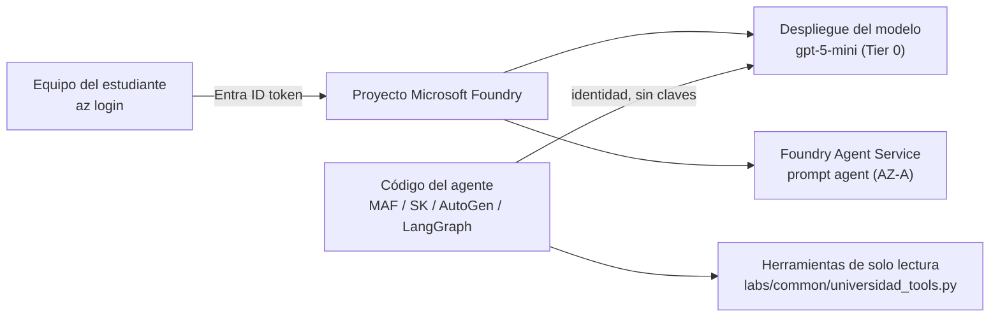

# Laboratorios Microsoft Azure (AZ-A a AZ-F)

> **Estado de validación (13-oct-2026):** AZ-B, AZ-C, AZ-D y AZ-E se ejecutaron completos **contra un simulador** (bucle modelo → herramienta → modelo) con las versiones fijadas en cada `requirements.txt`; ver `labs/VALIDACION.md`. **No se han ejecutado contra una suscripción real**: cuotas, permisos y el laboratorio de consola AZ-A deben validarse con una cuenta trial nueva siguiendo el plan de viabilidad de la planeación (Fase 1, sección 11).

| Lab | Tema | Estado tecnológico | Duración |
| --- | --- | --- | --- |
| AZ-A | Agente desde Microsoft Foundry (consola) | Foundry Agent Service, vigente | 60 min |
| AZ-B | Microsoft Agent Framework | Vigente: 1.0 GA desde 3-abr-2026, sucesor de SK y AutoGen | 90 min |
| AZ-C | Semantic Kernel | **Legado**: modo mantenimiento | 60 min |
| AZ-D | AutoGen | **Legado**: modo mantenimiento | 60 min |
| AZ-E | LangGraph con modelos de Azure | Framework **externo** (LangChain); Foundry puede alojarlo como hosted agent | 90 min |
| AZ-F | Arquitectura y comparación de enfoques | — | 60 min |

## Arquitectura común



## Prerrequisitos

- Cuenta trial de Azure creada **la semana del bloque Azure** (crédito por 30 días) y presupuesto configurado en Cost Management.
- Azure CLI con sesión iniciada (`az login`), Python 3.12.
- Rol que permita crear recursos en la suscripción (propietario de su trial) y el rol de usuario de Foundry en el proyecto para ejecutar código.

## Validación de cuota (obligatoria antes de AZ-A)

La documentación oficial de cuotas define niveles (Free Tier y Tiers 1–6). El **Tier 0** incluye gpt-4.1-mini (200.000 TPM), gpt-5-mini (500.000 TPM), o4-mini y text-embedding-3-small en despliegue GlobalStandard ([fuente](https://learn.microsoft.com/en-us/azure/foundry/openai/quotas-limits)). Consulte el nivel de su suscripción:

```bash
SUB=$(az account show --query id -o tsv)
az rest --method get \
  --url "https://management.azure.com/subscriptions/$SUB/providers/Microsoft.CognitiveServices/quotaTiers?api-version=2025-10-01-preview"
# Resultado esperado: "currentTierName": "Free Tier" (o un Tier superior)
```

Si el despliegue de gpt-5-mini falla por cuota, use la **ruta alternativa**: ejecute los laboratorios de código contra Ollama local. Agent Framework ofrece el cliente `OpenAIChatCompletionClient` (acepta `base_url`, verificado en 1.21.0; use `http://127.0.0.1:11434/v1`) y un paquete `agent-framework-ollama` en beta. SK, AutoGen y LangGraph requieren su cliente OpenAI genérico con `base_url`. Reemplace AZ-A por la demostración grabada del docente.

## Preparación común

```bash
az group create -n rg-llm-curso-<usuario> -l eastus2          # verifique región con cuota
cd labs/20-azure && cp .env.example .env                      # complete los valores
```

En el portal de Foundry (versión nueva): cree un proyecto dentro del grupo de recursos, despliegue `gpt-5-mini` como GlobalStandard y copie el endpoint del proyecto y el del recurso a `.env`. Las rutas de menú del portal cambian con frecuencia; siga la guía de inicio rápido oficial vigente.

## AZ-A · Agente desde Microsoft Foundry (consola)

1. En el proyecto, cree un agente (prompt agent) con el modelo `gpt-5-mini`.
2. Instrucciones: copie `INSTRUCCIONES_ASISTENTE` de `labs/common/universidad_tools.py`.
3. Pruebe en el playground: «¿Cuándo inician las clases?». Sin herramientas, el agente no conoce el dato: observe si lo reconoce o inventa (riesgo LLM09).
4. Revise la traza de la ejecución en el portal: tokens de entrada y salida, latencia.
5. Reflexión: ¿qué identidad usa el agente? ¿quién puede cambiar sus instrucciones (plano de control)?

**Resultado esperado:** agente respondiendo en el playground con trazas visibles.

## AZ-B · Microsoft Agent Framework

```bash
cd b-agent-framework
python3.12 -m venv .venv && source .venv/bin/activate
pip install -r requirements.txt
python agente_maf.py "¿Hasta cuándo puedo solicitar una homologación y qué requisitos tiene?"
```

**Resultado esperado:** una respuesta que cite la fecha (15-feb-2027) y el art. 45 del reglamento ficticio, obtenidos mediante las herramientas. Puntos de análisis: `FoundryChatClient` con `AzureCliCredential` (sin claves), herramientas como funciones Python tipadas, timeout explícito de 120 s.

## AZ-C · Semantic Kernel (legado)

```bash
cd c-semantic-kernel-legado && python3.12 -m venv .venv && source .venv/bin/activate
pip install -r requirements.txt && python agente_sk.py
```

Compare: en SK las herramientas se agrupan en *plugins* con `@kernel_function`; en Agent Framework se pasan funciones directamente. Lea la guía oficial de migración a Agent Framework y anote tres cambios.

## AZ-D · AutoGen (legado)

```bash
cd d-autogen-legado && python3.12 -m venv .venv && source .venv/bin/activate
pip install -r requirements.txt && python agente_autogen.py
```

Compare el modelo conversacional (`AssistantAgent.run(task=...)`) con el de Agent Framework. Identifique qué parte de AutoGen heredó Agent Framework (orquestación multiagente).

## AZ-E · LangGraph con modelos de Azure

```bash
cd e-langgraph-foundry && python3.12 -m venv .venv && source .venv/bin/activate
pip install -r requirements.txt && python grafo_langgraph.py
```

El grafo declara explícitamente nodos y aristas (modelo → herramientas → modelo) con un límite de pasos (`recursion_limit`). Diferencia clave: **orquestación explícita** (el desarrollador define el flujo) frente a **comportamiento agéntico** (el modelo decide el siguiente paso dentro del bucle).

### AZ-E · Extensión: el mismo grafo como hosted agent de Foundry

`hosted_agent.py` envuelve **el mismo grafo** con `ResponsesHostServer` (paquete `langchain-azure-ai[hosting]`), según la [guía oficial de hosted agents con LangChain/LangGraph](https://learn.microsoft.com/azure/foundry/how-to/develop/langchain-hosted-agents). El modelo se obtiene del proyecto de Foundry con identidad, sin claves.

Validado el 13-oct-2026 con langchain-azure-ai 1.2.10: el servidor local respondió `POST /responses` con estado `completed`, la llamada a la herramienta `calendario` y su resultado (contra el simulador). **No se desplegó en Foundry.**

```bash
pip install -r requirements-hosted.txt
export FOUNDRY_PROJECT_ENDPOINT="https://<recurso>.services.ai.azure.com/api/projects/<proyecto>"
export FOUNDRY_MODEL_NAME=gpt-5-mini
HOST=127.0.0.1 python hosted_agent.py
curl -X POST http://127.0.0.1:8088/responses -H "Content-Type: application/json" \
  -d '{"input": "¿Cuándo inician las clases?"}'
```

Despliegue (procedimiento oficial, requiere Docker local y el rol **Foundry Project Manager** en el proyecto):

```bash
azd ext install azure.ai.agents
azd auth login
azd ai agent init        # use la muestra oficial de LangGraph como plantilla y reemplace el código por hosted_agent.py
azd ai agent run         # prueba local en contenedor
azd deploy
```

Antes de desplegar, verifique el estado (GA o preview) y el soporte de red privada de los hosted agents en la documentación vigente.

## AZ-F · Arquitectura y comparación

| Criterio | Agent Framework | Semantic Kernel | AutoGen | LangGraph |
| --- | --- | --- | --- | --- |
| Estado | Vigente (1.x GA) | Mantenimiento | Mantenimiento | Externo, activo |
| Origen | Microsoft | Microsoft | Microsoft Research | LangChain |
| Modelo de herramientas | Funciones tipadas | Plugins | Funciones | Herramientas LangChain |
| Control del flujo | Agente y workflows | Agente y procesos | Conversación entre agentes | Grafo explícito |
| Hospedaje gestionado en Foundry | Hosted agents | — (migrar) | — (migrar) | Hosted agents |
| Uso recomendado en proyectos nuevos | Sí | No | No | Sí, si el equipo ya usa LangChain |

Entregable: diagrama del caso en Azure (D-18) con los servicios elegidos, responsabilidades gestionadas y una estimación de tokens por minuto frente a la cuota de su nivel.

## Seguridad y permisos mínimos

- Sin claves: `AzureCliCredential` / `DefaultAzureCredential`. En despliegue, identidad gestionada.
- Rol de usuario de Foundry para ejecutar; no use el rol de propietario en código.
- Herramientas de solo lectura sobre datos ficticios.

## Costos

Consumo de tokens del modelo y, si se usan, hosted agents. Con gpt-5-mini y las pruebas indicadas, el consumo esperado es pequeño frente al crédito trial, pero **no se ha medido**: registre el costo real en Cost Management tras el laboratorio.

## Solución de problemas

| Síntoma | Acción |
| --- | --- |
| Error de cuota al desplegar | Verificar nivel con `quotaTiers`; probar gpt-5-mini GlobalStandard en otra región; ruta alternativa |
| 401/403 desde el código | `az login`; asignar rol de usuario de Foundry en el proyecto |
| `ImportError` en SK, AutoGen o LangGraph | Las APIs cambian entre versiones: fije la versión validada en `requirements.txt` |
| 404 del despliegue | El nombre en `FOUNDRY_MODEL_DEPLOYMENT` debe coincidir con el despliegue |

## Limpieza

```bash
az group delete -n rg-llm-curso-<usuario> --yes --no-wait
az group list -o table     # verificar que no quedan grupos del curso
```

Revise Cost Management 24 horas después.

## Preguntas de reflexión

1. ¿Qué capa (SDK, runtime o servicio de modelos) cambió en cada uno de los laboratorios AZ-B a AZ-E?
2. ¿Por qué un proyecto nuevo no debería empezar con Semantic Kernel o AutoGen en 2026?
3. ¿Qué ventajas de gobierno aporta ejecutar el agente en Foundry Agent Service frente a un contenedor propio?
4. ¿Cómo afecta la cuota del nivel de su suscripción al diseño del caso universitario?
