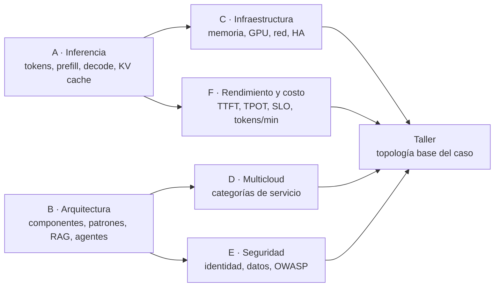

# Guía del estudiante · Sesión 1

**Arquitecturas Base para LLMs en la Nube** · Capítulo 1 · 180 minutos

Esta guía acompaña la clase y el trabajo autónomo. El desarrollo conceptual completo, con diagramas comentados y glosario, está en [`marco-teorico.md`](marco-teorico.md); aquí se encuentran los resultados esperados, las actividades, los ejercicios, la autoevaluación y las lecturas.

## 1. Resultados de aprendizaje

| RA | Al finalizar podrá… | Evidencia |
| --- | --- | --- |
| RA1 | Explicar el ciclo de vida de una solicitud de inferencia, diferenciando prefill, decode y KV cache | Cuestionario de cierre |
| RA2 | Identificar componentes de una arquitectura LLM empresarial y distinguir plano de control y de datos | Taller |
| RA3 | Comparar inferencia gestionada y autogestionada con al menos tres criterios | ADR del taller |
| RA4 | Estimar la memoria para servir un modelo según parámetros, precisión, contexto y concurrencia | Ejercicio 2 |
| RA5 | Interpretar TTFT, TPOT, throughput y saturación | Ejercicio 3 |
| RA6 | Relacionar categorías de servicio con AWS, Azure y Google Cloud | Actividad 4 |
| RA7 | Asociar riesgos OWASP LLM 2025 con controles por capa | Taller |
| RA8 | Diseñar una topología base justificada para el caso | Taller + tarea |

## 2. Mapa conceptual de la sesión

## 3. Glosario esencial

Los 24 términos del curso, con su definición operativa, están en la sección «Glosario técnico» del marco teórico. Antes de clase, asegúrese de poder explicar con sus palabras: token, context window, prefill, decode, KV cache, batching continuo, cuantización, RAG, runtime gestionado de agentes, TTFT, TPOT, SLI/SLO/SLA y workload identity.

## 4. Actividades durante la clase

**Actividad 1 · Predicción (Demo 1).** Antes de la demostración, escriba qué métrica cambiará más al anteponer tres párrafos de reglamento a la pregunta: TTFT o TPOT. Justifique en una línea. Después de la demo, compare con lo observado.

**Actividad 2 · Fallas por componente (Unidad B).** Para tres componentes de la arquitectura de referencia (D-06), escriba la falla típica y una mitigación.

**Actividad 3 · Cálculo rápido (Unidad C).** Con la fórmula de memoria, calcule la KV cache por token de un modelo con 32 capas, 8 kv_heads, d_head 128, en FP16.

**Actividad 4 · Mapa multicloud (Unidad D).** Complete la tabla sin consultar la diapositiva:

| Categoría | AWS | Azure | Google Cloud |
| --- | --- | --- | --- |
| Plataforma de modelos | | | |
| Runtime gestionado de agentes | | | |
| SDK de agentes del proveedor | | | |
| Identidad de cargas sin secretos | | | |

**Actividad 5 · Taller.** Ver [`caso-universitario/README.md`](caso-universitario/README.md).

## 5. Ejercicios para el trabajo autónomo

### Ejercicio 1 · Ciclo de vida

Dibuje el ciclo de vida de una solicitud del asistente universitario cuando la pregunta requiere RAG. Marque en el diagrama: dónde se autentica al usuario, dónde se filtran los documentos por permisos, dónde se mide el TTFT y dónde se registra la traza.

### Ejercicio 2 · Dimensionamiento

Un modelo open-weight de 14.000 millones de parámetros tiene 40 capas, 8 kv_heads y d_head 128. Se espera que 20 secuencias generen simultáneamente con contexto medio de 8.192 tokens.

1. Calcule la memoria de los pesos en FP16 y en INT4 (use 0,5 bytes por parámetro más un 10 % de metadatos).
2. Calcule la KV cache total en FP16.
3. Sume un margen del 15 % y determine qué clase de GPU (24, 48 u 80 GB) se requiere en cada precisión.
4. ¿Cuántas GPU necesita para 99,9 % de disponibilidad? Justifique.

### Ejercicio 3 · Lectura de una prueba de carga

| Concurrencia | TTFT p50 (ms) | TTFT p95 (ms) | Solicitudes/s |
| --- | --- | --- | --- |
| 1 | 114 | 132 | 0,91 |
| 2 | 115 | 119 | 1,83 |
| 4 | 1.194 | 1.213 | 1,83 |
| 8 | 1.758 | 3.394 | 1,83 |

1. ¿Cuál es la capacidad del servidor en solicitudes simultáneas? ¿Cómo lo sabe?
2. ¿Qué nivel de concurrencia cumple un SLO de TTFT p95 ≤ 500 ms?
3. Use la ley de Little para estimar cuántas solicitudes estarían en curso con 1,83 solicitudes/s y 2,2 s de latencia total.

### Ejercicio 4 · Demanda de tokens

Con los supuestos del caso, recalcule la demanda en tokens por minuto si el equipo reduce el contexto RAG de 3.000 a 1.500 tokens de entrada. ¿En qué porcentaje cambia la demanda total? ¿Qué implica para la cuota de una API gestionada?

### Ejercicio 5 · Selección tecnológica

Una facultad pide que el asistente pueda además **consultar el estado de una solicitud** en el sistema académico. Explique qué cambia en la arquitectura, qué riesgos OWASP aparecen o aumentan y qué controles aplicaría.

## 6. Autoevaluación

Responda sin consultar el material; luego verifique en el marco teórico.

1. ¿Por qué el decode está limitado por el ancho de banda de memoria y no por el cómputo?
2. ¿Qué crece cuando aumenta la concurrencia: los pesos, la KV cache o ambos?
3. ¿Qué diferencia hay entre un modelo open-weight y uno open source en sentido estricto?
4. Dé un ejemplo de plano de control y uno de plano de datos en el asistente.
5. ¿Por qué el streaming mejora la latencia percibida pero no la latencia total?
6. ¿Por qué la recuperación RAG debe filtrar por los permisos del usuario final y no por los del backend?
7. ¿Cuántos minutos de indisponibilidad admite un SLO de 99,9 % en 30 días?
8. ¿Por qué un SDK de agentes, un runtime gestionado y un servicio de modelos no son alternativas equivalentes?
9. ¿Qué tipo de costo tiene una API gestionada (fijo o variable) y cuál un despliegue propio con GPU?
10. ¿Qué control limita mejor el daño de una inyección indirecta de prompts?

## 7. Laboratorios asociados

| Laboratorio | Cuándo | Carpeta |
| --- | --- | --- |
| LOC-01 · Ollama, FastAPI y React | Semana 1 | `labs/00-local-ollama` |
| AZ-A a AZ-F · Microsoft Azure | Bloque Azure (crear la cuenta trial esa semana) | `labs/20-azure` |
| GCP-A a GCP-C · Google Cloud | Bloque Google Cloud | `labs/10-gcp` |
| AWS-A a AWS-D · AWS | Bloque AWS | `labs/30-aws` |
| MC-01 · Comparativo | Al cerrar los tres bloques | `labs/40-comparativo-multicloud` |

## 8. Lecturas recomendadas

1. Marco teórico de la sesión (obligatoria).
2. OWASP Top 10 for LLM Applications 2025 (obligatoria).
3. Kwon et al. (2023). *Efficient Memory Management for Large Language Model Serving with PagedAttention*. SOSP.
4. Documentación oficial: Foundry Agent Service overview; Amazon Bedrock AgentCore; Google ADK overview (enlaces en `docs/referencias.md`).
5. Google SRE Book, capítulo sobre objetivos de nivel de servicio.

## 9. Tarea

Completar el ADR del taller con la decisión gestionado vs. autogestionado para la nube elegida por su equipo, incluyendo: diagrama, al menos tres criterios, un SLO, una estimación de memoria o tokens por minuto y cinco riesgos con su control. Entrega en el repositorio del equipo.
