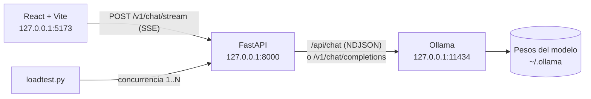

# LOC-01 · Inferencia local con Ollama, FastAPI y React

> Estado de validación (13-oct-2026):
> - ✅ Backend con 19 pruebas automatizadas (incluidas trazas OpenTelemetry), frontend (build) y prueba de carga ejecutados contra el simulador `scripts/mock_ollama.py`.
> - ✅ Backend probado contra **Ollama 0.40.3 real** (API nativa y `/v1`): verificación de salud, errores de modelo inexistente y su propagación por SSE. Esta prueba encontró y corrigió dos defectos del adaptador compatible con OpenAI.
> - ⏳ **Inferencia con un modelo real pendiente:** el entorno de preparación no tiene acceso al registro de modelos de Ollama. Debe ejecutarse en el equipo del docente (`ollama pull qwen2.5:1.5b`).
> - ⏳ `docker compose` no se pudo ejecutar: el entorno no tiene acceso a Docker Hub para descargar las imágenes base.

## 1. Objetivo y competencias

Ejecutar un LLM open-weight en el equipo del estudiante, exponerlo mediante una API propia y medir TTFT, TPOT, throughput y comportamiento bajo concurrencia. Refuerza RA1, RA3, RA4 y RA5 de la Sesión 1. Alimenta las demos 1, 2 y 4.

## 2. Arquitectura



El backend implementa el **contrato común del curso** (`/healthz`, `/readyz`, `/v1/chat`, `/v1/chat/stream`) y desacopla el proveedor mediante adaptadores (`app/providers/`). Cambiar de Ollama a un endpoint gestionado compatible con OpenAI es cambiar variables de entorno, no código.

## 3. Prerrequisitos

- Ubuntu 24.04 LTS o WSL2 con Ubuntu 24.04 (ver `docs/01-entorno-ubuntu-wsl.md`).
- Python 3.12, Node.js 20 o superior, Git. Docker es opcional.
- 10 GB libres en disco.

## 4. Hardware y elección de modelo

No se asume GPU. La memoria necesaria es aproximadamente el tamaño de los pesos cuantizados más la KV cache (Unidad C).

| Equipo del estudiante | Modelo sugerido | Tamaño aproximado de descarga | Comentario |
| --- | --- | --- | --- |
| 8 GB de RAM, sin GPU | `qwen2.5:1.5b` (predeterminado) | ~1 GB | Respuestas lentas pero funcionales en CPU |
| 8 GB de RAM, muy limitado | `qwen2.5:0.5b` | ~0,4 GB | Calidad baja; útil para medir, no para conversar |
| 16 GB de RAM o GPU de 6 GB o más | `llama3.2:3b` o `qwen2.5:3b` | ~2 GB | Mejor calidad en español |

Los tamaños son aproximados; confirme el valor real con `ollama list` después de descargar. Los nombres de modelos del catálogo de Ollama pueden cambiar: verifique en <https://ollama.com/library>.

## 5. Configuración del entorno

```bash
# 5.1 Instalar Ollama (script oficial; revíselo antes de ejecutarlo)
curl -fsSL https://ollama.com/install.sh | sh
ollama --version

# 5.2 Verificar que Ollama escucha SOLO en localhost
ss -ltnp | grep 11434        # debe mostrar 127.0.0.1:11434, no 0.0.0.0
# Nunca configure OLLAMA_HOST=0.0.0.0: Ollama no tiene autenticación.

# 5.3 Descargar el modelo y probarlo
ollama pull qwen2.5:1.5b
ollama run qwen2.5:1.5b "Explica en una frase qué es un token" --verbose
```

`--verbose` imprime métricas del propio Ollama (`prompt eval rate`, `eval rate`): son la primera evidencia de prefill frente a decode.

## 6. Procedimiento

### 6.1 Backend

```bash
cd labs/00-local-ollama
cp .env.example .env
cd backend
python3.12 -m venv .venv && source .venv/bin/activate
pip install -r requirements-dev.txt
pytest                                 # 19 pruebas, sin red ni Ollama
uvicorn app.main:app --host 127.0.0.1 --port 8000 --env-file ../.env
```

Validación:

```bash
curl -s http://127.0.0.1:8000/readyz
# {"status":"ok","provider":"ollama","model":"qwen2.5:1.5b","detail":null}

curl -sN -X POST http://127.0.0.1:8000/v1/chat/stream \
  -H 'Content-Type: application/json' \
  -d '{"messages":[{"role":"user","content":"¿Qué es un crédito académico?"}]}'
# event: token ... (varios)
# event: metrics  data: {"ttft_ms": ..., "tpot_ms": ..., "tokens_per_second": ...}
# event: done
```

**Windows PowerShell.** En PowerShell, `curl` no es el curl real, la barra `\` no continúa líneas y las comillas internas del JSON se pierden. Equivalente para PowerShell 5.1 y 7 (no se ejecutó en Windows durante la preparación; valídelo en su equipo):

```powershell
[Console]::OutputEncoding = [System.Text.Encoding]::UTF8
Invoke-RestMethod http://127.0.0.1:8000/readyz

$body = '{"messages":[{"role":"user","content":"¿Qué es un crédito académico?"}]}'
$file = Join-Path $env:TEMP 'chat.json'      # C:\Users\<usuario>\AppData\Local\Temp\chat.json
[System.IO.File]::WriteAllText($file, $body, [System.Text.UTF8Encoding]::new($false))   # UTF-8 sin BOM
curl.exe -sN -X POST http://127.0.0.1:8000/v1/chat/stream `
  -H "Content-Type: application/json" `
  --data-binary "@$file"
```

### 6.2 Frontend

```bash
cd labs/00-local-ollama/frontend
npm install
npm run dev        # abre http://127.0.0.1:5173
```

Cada respuesta muestra TTFT, TPOT, latencia total, tokens por segundo y tokens de entrada y salida.

### 6.3 Alternativa con Docker Compose

```bash
cd labs/00-local-ollama
cp .env.example .env
docker compose up -d --build
docker compose exec ollama ollama pull qwen2.5:1.5b
curl -s http://127.0.0.1:8000/readyz
```

Todos los puertos se publican en `127.0.0.1`. Con GPU NVIDIA y el NVIDIA Container Toolkit instalado, puede añadirse la reserva de GPU al servicio `ollama`; no es necesaria para el laboratorio.

## 7. Demostraciones de clase

| Demo | Qué hacer | Qué observar |
| --- | --- | --- |
| 1 · Anatomía de una solicitud | Pregunta corta y luego la misma pregunta precedida de un texto largo (copie 2–3 párrafos de un reglamento) | El TTFT crece con el prompt (prefill); el TPOT casi no cambia (decode) |
| 2 · Misma API, dos backends | Cambie a `APP_PROVIDER=openai_compat` y `APP_OPENAI_BASE_URL=http://127.0.0.1:11434/v1`, reinicie el backend | El frontend y el contrato no cambian; solo el adaptador |
| 4 · Concurrencia vs. latencia | `python load-tests/loadtest.py --levels 1 2 4 8 --requests 8` | El TTFT p95 crece de forma no lineal al superar la capacidad |

**Plan de contingencia (sin Ollama).** El simulador reproduce prefill, decode y cola con cifras sintéticas:

```bash
python scripts/mock_ollama.py --port 11434 --batch 2
```

Resultado obtenido con el simulador en el entorno del curso (13-oct-2026). Son **cifras sintéticas**, útiles para explicar la forma de la curva, no para dimensionar:

| Concurrencia | TTFT p50 (ms) | TTFT p95 (ms) | E2E p95 (ms) | Solicitudes/s |
| --- | --- | --- | --- | --- |
| 1 | 113,9 | 132,0 | 1.110,8 | 0,91 |
| 2 | 115,3 | 118,7 | 1.095,7 | 1,83 |
| 4 | 1.193,9 | 1.212,8 | 2.187,8 | 1,83 |
| 8 | 1.757,5 | 3.394,2 | 4.372,0 | 1,83 |

Lectura: con capacidad 2, el throughput deja de crecer a partir de concurrencia 2 y el exceso se convierte en cola (TTFT).

## 8. Métricas a registrar

Por cada modelo probado: TTFT p50 y p95, TPOT, tokens/s, RAM usada (`free -h` o el administrador de tareas) y, si hay GPU, VRAM (`nvidia-smi`). Compare la RAM medida con la estimación de la Unidad C.

## 8.1 Observabilidad con OpenTelemetry

El backend emite trazas OpenTelemetry cuando `APP_OTEL_ENABLED=true`:

- Un span HTTP por solicitud (instrumentación de FastAPI; se excluyen `/healthz` y `/readyz`).
- Un span hijo `chat <modelo>` con atributos de las convenciones semánticas GenAI (`gen_ai.operation.name`, `gen_ai.provider.name`, `gen_ai.request.model`, `gen_ai.usage.input_tokens`, `gen_ai.usage.output_tokens`) y las métricas de la Unidad F (`app.ttft_ms`, `app.tpot_ms`, `app.e2e_ms`).
- Nunca se registra el contenido de prompts ni respuestas (lo verifica una prueba automatizada).

```bash
APP_OTEL_ENABLED=true APP_OTEL_EXPORTER=console uvicorn app.main:app --port 8000   # spans en consola
# Con un colector OTLP (por ejemplo, OpenTelemetry Collector o el endpoint OTLP de su nube):
APP_OTEL_ENABLED=true APP_OTEL_EXPORTER=otlp OTEL_EXPORTER_OTLP_ENDPOINT=http://127.0.0.1:4318 uvicorn app.main:app
```

Las convenciones GenAI de OpenTelemetry están en estado de desarrollo: los nombres de atributos pueden cambiar entre versiones de la especificación.

## 9. Seguridad y permisos mínimos

- Ollama, backend y frontend escuchan solo en `127.0.0.1`.
- El backend limita caracteres de entrada (`APP_MAX_INPUT_CHARS`) y tokens de salida (`APP_MAX_OUTPUT_TOKENS`): mitigación de OWASP LLM10.
- Los logs registran métricas y longitudes, no el contenido de las conversaciones.
- `.env` está excluido de git; no hay secretos en el código ni en la imagen Docker (usuario no root).

## 10. Costos

Sin costos cloud. El costo es energía y tiempo de cómputo del equipo.

## 11. Solución de problemas

| Síntoma | Causa probable | Acción |
| --- | --- | --- |
| `/readyz` responde 503 «modelo no descargado» | El modelo de `.env` no está en Ollama | `ollama pull <modelo>` |
| `/readyz` responde 503 «Ollama no responde» | Servicio detenido | `systemctl status ollama` o `ollama serve` |
| Respuestas muy lentas | Modelo grande para la RAM disponible, uso de swap | Usar un modelo más pequeño; cerrar aplicaciones |
| En WSL el frontend no conecta | Puerto o proxy | Abrir `http://127.0.0.1:5173` desde Windows; verificar que backend corre en WSL |
| `address already in use` en 11434 | Ollama nativo y el simulador o Docker a la vez | Detener uno de los dos |

## 12. Limpieza

```bash
ollama rm qwen2.5:1.5b                 # libera el espacio del modelo
docker compose down -v                 # si usó Docker (elimina el volumen de modelos)
# Desinstalar Ollama: ver la documentación oficial en https://github.com/ollama/ollama
```

## 13. Qué cambia al llevar esta arquitectura a la nube

| Local | En la nube |
| --- | --- |
| Un proceso en `127.0.0.1` | Endpoint privado o detrás de un API Gateway con autenticación |
| CPU o GPU del equipo | GPU dedicada (self-hosting) o API gestionada facturada por token |
| Una réplica | Al menos dos réplicas en zonas distintas para 99,9 % |
| Logs en consola | Observabilidad centralizada con trazas por solicitud |
| Sin identidad | Identidad de usuario (OIDC) e identidad de carga de trabajo |

## 14. Preguntas de reflexión

1. ¿Por qué el TTFT cambió con el prompt largo y el TPOT no?
2. Con sus mediciones, ¿cuántos usuarios simultáneos atendería su equipo con un TTFT p95 inferior a 2 s?
3. ¿Qué componentes de este laboratorio serían puntos únicos de fallo en producción?
4. Si el asistente pasa a un modelo gestionado, ¿qué métricas de esta tabla deja de controlar la universidad y cuáles sigue siendo responsable de medir?
