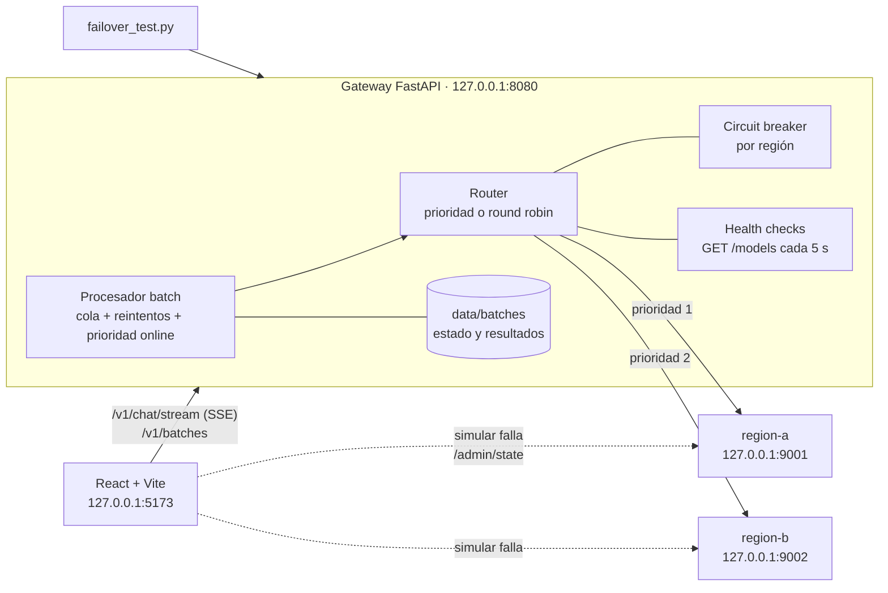

# LOC-02 · Gateway multi-región con inferencia online y por lotes

> Estado de validación (20-oct-2026):
> - ✅ 36 pruebas automatizadas del gateway (circuit breaker, enrutamiento, failover, streaming, lotes, seguridad) y 15 del generador de lotes, sin red.
> - ✅ Ejecución de punta a punta con dos regiones simuladas: prueba de conmutación bajo carga (120 solicitudes, 0 errores) y lote de 200 PQRS con la región primaria caída a mitad del trabajo. Las cifras son **sintéticas**.
> - ✅ Frontend compilado y recorrido con un navegador automatizado (pestañas Online, Regiones y Lotes).
> - ⏳ Modo híbrido con Ollama real y modo nube con dos recursos de Foundry: pendientes en el equipo del docente.
> - ⏳ `docker compose` no se ejecutó (sin acceso a Docker Hub en el entorno de preparación).

## 1. Objetivo y competencias

Construir y operar, en el equipo del estudiante, una versión a escala de laboratorio de la topología que la Sesión 2 analiza en la nube:

- **Inferencia online y por lotes sobre la misma capacidad**, con prioridad para lo interactivo.
- **Dos "regiones"** con failover activo-pasivo o reparto activo-activo.
- **Health checks** activos y **circuit breaker** pasivo por región.
- **Ciclo de vida batch** equivalente al de Azure OpenAI Batch, Gemini batch inference y Amazon Bedrock batch.

Al terminar, el estudiante puede explicar con evidencia propia qué detecta la falla, cuánto tarda la conmutación, qué ve el usuario y por qué un lote no debe competir con el tráfico online.

## 2. Arquitectura



Las regiones son procesos independientes compatibles con la API Chat Completions. Pueden ser:

| Modo | Región primaria | Región secundaria | Para qué sirve |
| --- | --- | --- | --- |
| Simulado (predeterminado) | `scripts/mock_region.py` | `scripts/mock_region.py` | Demostrar fallas sin GPU ni nube |
| Híbrido | Ollama local (`/v1`) | Región simulada o endpoint cloud | Conmutar de local a nube |
| Nube | Foundry en una región | Foundry en otra región | Repetir la demo con servicios reales (ver AZ-G) |

## 3. Prerrequisitos

- Haber completado LOC-01 (Sesión 1): mismo entorno Ubuntu 24.04 o WSL2, Python 3.12, Node.js 20+.
- Opcional: Ollama con `qwen2.5:1.5b` para el modo híbrido.

## 4. Requerimientos de hardware y software

| Recurso | Mínimo |
| --- | --- |
| RAM | 4 GB libres (modo simulado); 8 GB con Ollama |
| CPU | 2 núcleos |
| Disco | 500 MB (sin modelos) |
| Software | Python 3.12, Node.js 20+, Git; Docker opcional |

## 5. Configuración del entorno

```bash
cd labs/01-local-gateway
cp .env.example .env
python3.12 -m venv .venv && source .venv/bin/activate
pip install -r backend/requirements-dev.txt
cd backend && pytest -q && cd ..         # 36 pruebas, sin red
```

## 6. Procedimiento

### 6.1 Iniciar las regiones y el gateway (tres terminales)

```bash
# Terminal 1 y 2: las "regiones"
python scripts/mock_region.py --name region-a --port 9001
python scripts/mock_region.py --name region-b --port 9002

# Terminal 3: el gateway
cd backend && uvicorn app.main:app --host 127.0.0.1 --port 8080 --env-file ../.env
```

### 6.2 Validar el contrato online

```bash
curl -s http://127.0.0.1:8080/readyz
# {"status":"ok","routing":"priority","available_regions":["region-a","region-b"],"detail":null}

curl -s -X POST http://127.0.0.1:8080/v1/chat \
  -H 'Content-Type: application/json' \
  -d '{"messages":[{"role":"user","content":"¿Qué es un crédito académico?"}]}'
# ... "metrics": {..., "region": "region-a", "attempts": 1, "failover": false}

curl -s http://127.0.0.1:8080/v1/regions      # salud, circuito y tráfico por región
```

En PowerShell use `Invoke-RestMethod` o `curl.exe` (ver la sección «Windows PowerShell» de LOC-01).

### 6.3 Provocar una falla regional

```bash
curl -s -X POST http://127.0.0.1:9001/admin/state -H 'Content-Type: application/json' -d '{"mode":"down"}'
curl -s -X POST http://127.0.0.1:8080/v1/chat -H 'Content-Type: application/json' \
  -d '{"messages":[{"role":"user","content":"hola"}]}'
# "region": "region-b"  (y "failover": true si el health check aún no había detectado la caída)
curl -s -X POST http://127.0.0.1:9001/admin/state -H 'Content-Type: application/json' -d '{"mode":"healthy"}'
```

Modos disponibles: `healthy`, `down` (503), `slow` (supera el timeout de primer byte), `throttle` (429 con `Retry-After`) y `flaky` (500 intermitente).

### 6.4 Frontend

```bash
cd frontend && npm install && npm run dev      # http://127.0.0.1:5173
```

- **Online:** muestra qué región atendió y si hubo conmutación.
- **Regiones:** estado en vivo; botones para simular fallas y para retirar una región de la rotación (mantenimiento).
- **Lotes:** envía un lote de ejemplo o un JSONL, muestra el progreso y las regiones usadas, permite cancelar y descargar resultados.

### 6.5 Inferencia por lotes

```bash
python scripts/generar_lote.py --n 200 --salida data/lote.jsonl
python scripts/generar_lote.py --n 200 --formato etiquetas --salida data/etiquetas.jsonl

curl -s -X POST "http://127.0.0.1:8080/v1/batches?description=pqrs-nocturnas" \
  -H 'Content-Type: application/jsonl' --data-binary @data/lote.jsonl
# {"id":"batch_...","status":"validating","request_counts":{"total":200,...}}

curl -s http://127.0.0.1:8080/v1/batches/<id>                 # in_progress -> completed
curl -s http://127.0.0.1:8080/v1/batches/<id>/output -o data/salida.jsonl
python scripts/evaluar_lote.py --resultados data/salida.jsonl --etiquetas data/etiquetas.jsonl
```

El mismo `lote.jsonl` (formato OpenAI) es la entrada de Azure OpenAI Batch en AZ-G; `--formato gemini` y `--formato bedrock` generan la entrada de GCP-D y AWS-E. `evaluar_lote.py` lee la salida de los cuatro entornos.

### 6.6 Modo híbrido con Ollama

Use la opción 2 de `.env.example` (Ollama como primaria, región simulada como respaldo). Detenga Ollama (`sudo systemctl stop ollama`) durante una conversación y observe la conmutación; reinícielo y observe la recuperación.

## 7. Código

| Archivo | Responsabilidad |
| --- | --- |
| `backend/app/config.py` | Regiones y parámetros de resiliencia por variables de entorno |
| `backend/app/region_client.py` | Cliente Chat Completions; clasifica fallas reintentables y no reintentables |
| `backend/app/circuit_breaker.py` | Estados closed, open y half-open; respeta `Retry-After` |
| `backend/app/router.py` | Orden de candidatos, failover solo antes del primer token, health checks |
| `backend/app/batch.py` | Validación JSONL, ciclo de vida, reintentos, prioridad online, reanudación |
| `backend/app/main.py` | API online, regiones, administración y lotes |
| `scripts/mock_region.py` | Región simulada con modos de falla |
| `load-tests/failover_test.py` | Demo 3: carga constante con caída y recuperación de la primaria |

## 8. Demostraciones de clase

| Demo | Qué hacer | Qué observar |
| --- | --- | --- |
| 1 · Online vs. lote | Envíe un lote de 200 desde la pestaña Lotes y converse a la vez en la pestaña Online | El lote se detiene mientras hay solicitudes online; la latencia online no se degrada |
| 2 · Falla regional bajo carga | `python load-tests/failover_test.py --duracion 40 --falla-en 10 --recupera-en 25` | Ventana de detección, conmutación y recuperación con half-open |
| 4 (opcional) · 429 y Retry-After | Modo «429» en region-a desde la pestaña Regiones | El circuito se abre exactamente el tiempo indicado por `Retry-After` |

La Demo 3 de la sesión se hace en Azure (laboratorio AZ-G).

## 9. Resultados esperados

Resultado obtenido en el entorno de preparación (20-oct-2026) con `--duracion 30 --falla-en 8 --recupera-en 18 --ventana 2`. **Cifras sintéticas.**

| Ventana (s) | Solicitudes | Error % | Regiones |
| --- | --- | --- | --- |
| 0–8 | 32 | 0,0 | region-a |
| 8–22 | 56 | 0,0 | region-b |
| 22–24 | 8 | 0,0 | region-a 1 · region-b 7 |
| 24–30 | 24 | 0,0 | region-a |

Resumen: 120 solicitudes, disponibilidad observada 100 %, 3 conmutaciones, p95 de 838 ms.

**Lectura:** la región primaria volvió a recibir tráfico unos 4–6 s después de recuperarse. Ese retraso es deliberado: el circuito abierto (15 s) y el intervalo del health check (5 s) evitan enviar tráfico a una región que podría estar oscilando.

Lote de 200 PQRS con la región primaria caída a los 3 s: estado `completed`, 200 de 200 resueltas (region-a 14, region-b 186), 200 JSON válidos. Exactitud del clasificador simulado: área 100 %, tipo 89,5 %. El simulador clasifica por palabras clave; el 10,5 % de error en tipo muestra por qué la calidad de un lote se mide, no se supone.

## 10. Pruebas de validación

```bash
cd backend && pytest -q        # 36 pruebas
cd ../.. && pytest -q common/tests
```

Cubren: transiciones del circuit breaker, ventana de fallas, `Retry-After` con tope, failover por caída, por lentitud y por 429, ausencia de failover ante errores 4xx, presupuesto de intentos, streaming con evento `region`, health checks, token de administración, validación de lotes (BOM, JSON, duplicados, URL, roles, máximo), cancelación, expiración, prioridad online, reanudación sin repetir solicitudes, ids manipulados y ausencia de contenido en los logs.

## 11. Métricas

Por cada experimento registre: tiempo hasta detectar la falla, solicitudes fallidas durante la conmutación, p95 antes, durante y después, porcentaje servido por cada región y, en lotes, solicitudes por minuto con y sin tráfico online.

## 12. Seguridad y permisos mínimos

- Todos los procesos escuchan en `127.0.0.1`; en Docker los puertos se publican solo en `127.0.0.1`.
- Las claves de las regiones cloud se leen de variables de entorno nombradas en `api_key_env`; nunca están en `APP_REGIONS` ni en el repositorio.
- `/admin/*` exige `X-Admin-Token` cuando `APP_ADMIN_TOKEN` está definido; la comparación es de tiempo constante.
- El panel `/admin/state` de las regiones simuladas no tiene autenticación: es una herramienta de laboratorio y no debe exponerse.
- Los logs registran región, latencia y tokens, nunca el contenido de prompts o respuestas (lo verifica una prueba).
- Los ids de trabajo se validan antes de construir rutas de archivo (prueba de recorrido de rutas).
- El clasificador recibe PQRS con instrucciones incrustadas (2 % del lote): el prompt de sistema las trata como datos (OWASP LLM01).

## 13. Costos

Sin costos cloud en los modos simulado e híbrido. En el modo nube, cada solicitud se factura en la región que la atiende; una región secundaria «en espera» con despliegues de pago por token no genera costo mientras no recibe tráfico.

## 14. Solución de problemas

| Síntoma | Causa probable | Acción |
| --- | --- | --- |
| `/readyz` 503 con ambas regiones sanas | El gateway arrancó antes que las regiones | Espere un ciclo de health check (5 s) |
| Error de validación de `APP_REGIONS` | JSON inválido o nombre con mayúsculas | Valide el JSON; nombres en minúsculas y guiones |
| Los botones de falla no funcionan | Simulador iniciado antes de esta versión o puerto distinto | Reinicie `mock_region.py`; revise `sim_admin_url` |
| Lote `failed` al enviarlo | Archivo con BOM, JSON inválido o `custom_id` duplicado | Lea `errors` en la respuesta 400 |
| El lote avanza muy lento | Hay tráfico online y el lote cede capacidad | Es el comportamiento esperado; ajuste `APP_BATCH_YIELD_ONLINE_INFLIGHT` |
| `address already in use` | Otro proceso usa 8080, 9001 o 9002 | Detenga el proceso o cambie el puerto |

## 15. Limpieza

```bash
# Detenga los procesos con Ctrl+C en cada terminal.
rm -rf data/batches data/*.jsonl          # resultados de lotes
docker compose down -v                    # si usó Docker
```

## 16. Preguntas de reflexión

1. En la prueba de conmutación, ¿qué componente detectó primero la falla: el health check o el circuit breaker? ¿Qué cambia si sube `APP_HEALTH_INTERVAL_S` a 60?
2. ¿Por qué el gateway no conmuta cuando la región falla después del primer token? ¿Qué alternativa daría una mejor experiencia y qué costo tendría?
3. Si las dos «regiones» comparten la misma cuota de suscripción en la nube, ¿qué tipo de falla sigue cubriendo esta topología y cuál ya no?
4. ¿Qué pasaría con la latencia online si el procesador de lotes no cediera capacidad? Diseñe el experimento para demostrarlo.
5. El gateway es ahora un punto único de falla. ¿Cómo lo eliminaría en una nube sin perder el control de la conmutación?
