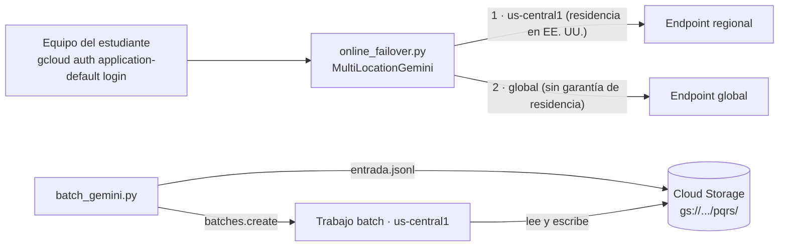

# GCP-D · Topologías en Google Cloud: ubicaciones de Gemini y batch inference

> **Estado de validación (20-oct-2026):**
> - ✅ Lógica de conmutación y flujo batch probados **con clientes simulados** (10 pruebas, `google-genai==2.31.0`).
> - ⏳ **No se ha ejecutado contra un proyecto real.** Cuotas, nombres de menú, identificador del modelo vigente y tiempos de cola deben validarse con la cuenta de prueba antes de la clase.
> - ℹ️ Vertex AI se presenta desde el 22-abr-2026 como **Gemini Enterprise Agent Platform**. El SDK `google-genai` 2.x usa `enterprise=True` (y la variable `GOOGLE_GENAI_USE_ENTERPRISE`) para apuntar a la plataforma.

## 1. Objetivo y competencias

- Comprender la **ubicación del endpoint** (regional, multirregional o `global`) como una decisión de disponibilidad **y** de residencia de datos.
- Conmutar entre ubicaciones desde el código y medir el efecto.
- Ejecutar el lote PQRS con **batch inference** desde Cloud Storage y compararlo con las demás nubes.

## 2. Arquitectura



| Hecho documentado (20-oct-2026) | Consecuencia | Fuente |
| --- | --- | --- |
| Las solicitudes al endpoint `global` «pueden procesarse en cualquier ubicación de Google Cloud» y no ofrecen aislamiento regional ni garantías de residencia | `global` es una opción de disponibilidad, no de cumplimiento | [Where your data lives and is processed](https://docs.cloud.google.com/gemini-enterprise-agent-platform/resources/data-residency) |
| Los endpoints regionales y multirregionales (`us`, `eu`) mantienen el procesamiento dentro de la jurisdicción; el `eu` excluye Reino Unido y Suiza | Para datos con restricción, se elige la ubicación primero y la disponibilidad después | Misma fuente |
| Los modelos Gemini están disponibles en modo batch con 50 % de descuento; la entrada y la salida pueden estar en Cloud Storage o BigQuery | El lote nocturno cuesta la mitad por token | [Pricing](https://cloud.google.com/vertex-ai/generative-ai/pricing) · [Batch inference](https://docs.cloud.google.com/gemini-enterprise-agent-platform/models/deploy/batch-inference) |
| Existen modalidades Standard, **Flex** y **Priority PayGo** además de Provisioned Throughput | La «clase de servicio» se elige por solicitud según el SLO | [Priority PayGo](https://docs.cloud.google.com/gemini-enterprise-agent-platform/models/priority-paygo) |
| La prueba gratuita no incluye GPU ni modelos de terceros como servicio, y el crédito no cubre la Gemini API de AI Studio | Use Gemini desde la plataforma, no desde AI Studio | [Free Trial](https://docs.cloud.google.com/free/docs/free-cloud-features) |

## 3. Prerrequisitos

- Proyecto `llm-curso-<usuario>` de la Sesión 1 con presupuesto y la API de la plataforma habilitada.
- `gcloud auth application-default login`.
- Roles para el estudiante: **Vertex AI User** (`roles/aiplatform.user`) en el proyecto y **Storage Object Admin** solo sobre el bucket del laboratorio.

## 4. Requerimientos de hardware y software

Python 3.12 y Google Cloud CLI. Sin GPU.

## 5. Configuración del entorno

```bash
cd labs/11-gcp-topologias
python3.12 -m venv .venv && source .venv/bin/activate
pip install -r requirements-dev.txt
pytest -q                       # 10 pruebas sin red
cp .env.example .env
gcloud storage buckets create gs://llm-curso-<usuario>-batch --location=us-central1 \
  --uniform-bucket-level-access --public-access-prevention
```

## 6. Procedimiento

### GCP-D.1 · Consola: ubicaciones y modelo vigente (10 min)

1. En la consola, abra Model Garden y localice el modelo Flash vigente. Anote su identificador, las ubicaciones disponibles (incluido `global`) y las modalidades de consumo (batch, Flex, Priority). Las notas de versión registran Gemini 3.8 Flash como GA desde el 2-sep-2026. **Gemini 2.5 tiene retiro anunciado**: si su `.env` de la Sesión 1 usa `gemini-2.5-flash`, actualícelo.
2. Copie el identificador en `GEMINI_MODEL`.

### GCP-D.2 · Código: pregunta con conmutación (15 min)

```bash
python online_failover.py "¿Hasta cuándo puedo solicitar una homologación?"
python online_failover.py "hola" --repeticiones 10
```

Puntos de análisis en `multiregion_gcp.py`:

- `retry_options=HttpRetryOptions(attempts=1)`: el SDK reintenta 5 veces por defecto, lo que retrasaría la conmutación.
- Se conmuta ante 408, 429 y 5xx y ante errores de transporte; no ante 4xx.

### GCP-D.3 · Comparar regional y global (10 min)

Cambie `GCP_LOCATIONS` a `["global"]` y luego a `["us-central1"]`; repita con `--repeticiones 10`. Registre p50 y máximo. Discuta: ¿cuál usaría para el asistente de estudiantes si la política de datos exige procesamiento en EE. UU.?

### GCP-D.4 · Simular la caída de la ubicación primaria (5 min)

Ponga primero una ubicación inexistente: `GCP_LOCATIONS=["us-nowhere1", "us-central1"]`. La primera solicitud muestra `intentos=2`.

Si la plataforma responde 400 o 404 para una ubicación inválida, **no habrá conmutación**: es un error de configuración, no una falla regional. Use ese resultado en la discusión.

### GCP-D.5 · Batch inference desde la consola (15 min)

1. Genere y suba el lote: `python batch_gemini.py preparar --n 200`.
2. En la consola de la plataforma, abra **Batch inference** y cree un trabajo: modelo `GEMINI_MODEL`, origen `gs://<bucket>/pqrs/entrada.jsonl`, destino `gs://<bucket>/pqrs/salida/`, región `us-central1`.
3. Observe los estados del trabajo.

### GCP-D.6 · Batch inference desde el código (15 min + espera)

```bash
python batch_gemini.py enviar
python batch_gemini.py estado --esperar
python batch_gemini.py descargar
python ../01-local-gateway/scripts/evaluar_lote.py --resultados data/salida_gemini.jsonl --etiquetas data/etiquetas.jsonl
```

El formato de entrada es una línea por solicitud con el campo `request` (cuerpo de `GenerateContent`). La salida repite la solicitud junto a la respuesta; `evaluar_lote.py` empareja por el texto de la PQRS.

### GCP-D.7 · Arquitectura de referencia (taller)

Complete la topología multi-región de Google Cloud del taller de la Sesión 2. Considere: Cloud Run del backend en dos regiones detrás de un balanceador global, ubicación del modelo según la residencia, cola de Pub/Sub o Cloud Scheduler para el lote nocturno, y dónde viven los índices de RAG.

## 7. Resultados esperados

| Paso | Resultado |
| --- | --- |
| GCP-D.2 | Respuesta desde `us-central1`, 1 intento |
| GCP-D.4 | `intentos=2` si la ubicación inválida devuelve un error reintentable; error explícito si devuelve 4xx |
| GCP-D.6 | Estado `JOB_STATE_SUCCEEDED` y 200 respuestas evaluadas |

## 8. Pruebas de validación

`pytest -q` cubre: primaria sana, conmutación ante 429/500/503 y ante errores de transporte, ausencia de conmutación ante 4xx, pausa y recuperación, `service_tier` y `system_instruction` en la configuración, reintentos del SDK desactivados, y el flujo batch (subida, creación con origen y destino, consulta y descarga).

## 9. Seguridad y permisos mínimos

- Credenciales de aplicación de `gcloud`; ninguna clave en el repositorio.
- Bucket con acceso uniforme y prevención de acceso público.
- Si el trabajo batch falla por permisos sobre el bucket, revise que el agente de servicio de la plataforma del proyecto tenga lectura y escritura **solo sobre ese bucket**.
- `global` puede procesar datos fuera de EE. UU.; no lo use con datos personales reales sin una decisión documentada.

## 10. Costos

Tokens del lote al precio batch (50 % del estándar según la página de precios) más almacenamiento mínimo en Cloud Storage. Consulte el precio vigente del modelo elegido en la [página oficial](https://cloud.google.com/vertex-ai/generative-ai/pricing). Use el crédito de la prueba gratuita y el presupuesto con alertas.

## 11. Solución de problemas

| Síntoma | Causa probable | Acción |
| --- | --- | --- |
| `404` del modelo | Identificador retirado o no disponible en la ubicación | Verifique en Model Garden; actualice `GEMINI_MODEL` |
| `PERMISSION_DENIED` en batch | El agente de servicio no puede leer o escribir el bucket | Conceda acceso solo al bucket del laboratorio |
| `429 RESOURCE_EXHAUSTED` | Cuota de la cuenta de prueba | Reduzca `--repeticiones`; espere; revise cuotas |
| El trabajo queda mucho tiempo en cola | Batch no tiene SLA de latencia | Es esperado; use `estado --esperar` |
| `descargar` no encuentra archivos | El trabajo no terminó o falló | Revise `estado` y el error del trabajo |

## 12. Limpieza

```bash
python batch_gemini.py cancelar                         # si quedó en curso
gcloud storage rm -r gs://llm-curso-<usuario>-batch
# Al final del curso: gcloud projects delete llm-curso-<usuario>
```

## 13. Preguntas de reflexión

1. ¿Qué ventaja de disponibilidad ofrece `global` y qué renuncia implica? ¿Cómo lo justificaría en un ADR?
2. ¿Usaría Flex PayGo o batch para el lote nocturno? Compare plazo, precio y complejidad operativa.
3. Si el backend corre en Cloud Run en dos regiones, ¿dónde debe quedar el estado de las conversaciones para que la conmutación no pierda contexto?
