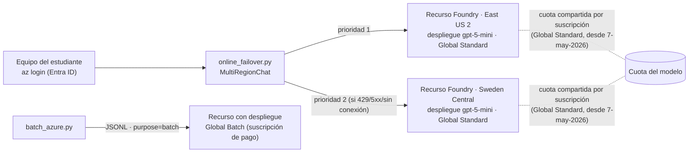

# AZ-G · Topologías en Microsoft Azure: multi-región y batch

> **Estado de validación (20-oct-2026):**
> - ✅ Lógica de conmutación y flujo batch probados **contra un transporte HTTP simulado** (8 pruebas, `openai==3.35.1`).
> - ⏳ **No se ha ejecutado contra una suscripción real.** Pasos de consola, nombres de menú, cuotas y latencias deben validarse con una cuenta trial nueva antes de la clase.
> - ⚠️ **Batch no está disponible en cuentas trial:** la tabla oficial de cuotas muestra «N/A» para Global Batch y Data Zone Batch en suscripciones *free trial* y *Azure for Students* ([Quotas and limits](https://learn.microsoft.com/en-us/azure/foundry/openai/quotas-limits), actualizada el 20-ago-2026). AZ-G.6 es una demostración del docente con suscripción de pago.

## 1. Objetivo y competencias

- Desplegar el mismo modelo en **dos regiones** y conmutar entre ellas desde el código (activo-pasivo).
- Distinguir lo que el proveedor ya resuelve (enrutamiento global de los despliegues *Global Standard*) de lo que sigue siendo responsabilidad propia (falla del endpoint regional, cuota, residencia de datos).
- Ejecutar el lote PQRS con **Azure OpenAI Batch** y compararlo con la ejecución local y con las otras nubes.
- Conocer el patrón gestionado equivalente: **API Management** con pool de backends y circuit breaker.

Refuerza las unidades B (online vs. batch), C (multi-región) y D (selección de servicios) de la Sesión 2.

## 2. Arquitectura



Hechos documentados que guían el diseño (verificados el 20-oct-2026):

| Hecho | Consecuencia para la topología | Fuente |
| --- | --- | --- |
| *Global Standard* procesa la inferencia en cualquier región de Azure; *Data Zone* solo dentro de la zona (EE. UU., UE o APAC); *Standard* dentro de la geografía elegida. Los datos en reposo permanecen en la geografía designada | El tipo de despliegue es una decisión de residencia de datos, no solo de precio | [Deployment types](https://learn.microsoft.com/azure/foundry/foundry-models/concepts/deployment-types) (12-ago-2026) |
| Con Global Standard y Data Zone Standard, si la región primaria sufre una interrupción, todo el tráfico enrutado a esa región se ve afectado | El enrutamiento global del proveedor **no** sustituye el failover propio entre endpoints regionales | Misma fuente; [alta disponibilidad de Foundry](https://learn.microsoft.com/en-us/azure/ai-services/openai/how-to/business-continuity-disaster-recovery) (22-sep-2026) |
| Desde el 7-may-2026 la cuota de Global Standard es por suscripción y se comparte entre regiones | Un segundo despliegue en otra región **no duplica** la cuota; protege contra la falla regional, no contra el 429 por cuota | [Quotas and limits](https://learn.microsoft.com/en-us/azure/foundry/openai/quotas-limits) |
| Batch: 50 % menos que Global Standard, objetivo de 24 h, cuota de tokens encolados separada de la online | El lote no compite con la cuota online | [Batch](https://learn.microsoft.com/azure/foundry/openai/how-to/batch) (5-jun-2026) |
| Foundry no ofrece failover automático; proyectos, despliegues y cuota se crean en cada región | La región secundaria se prepara y se prueba antes del incidente | Guía de alta disponibilidad de Foundry |

## 3. Prerrequisitos

- Cuenta trial de Azure con presupuesto configurado (ver `docs/03-costos-y-limpieza.md`) y el entorno de AZ-A a AZ-F (Sesión 1).
- Azure CLI con sesión iniciada (`az login`).
- Para AZ-G.6: suscripción de pago con cuota Global Batch (solo docente).

## 4. Requerimientos de hardware y software

Cualquier equipo con Python 3.12 y Azure CLI. Sin GPU.

## 5. Configuración del entorno

```bash
cd labs/21-azure-topologias
python3.12 -m venv .venv && source .venv/bin/activate
pip install -r requirements-dev.txt
pytest -q                      # 8 pruebas sin red
cp .env.example .env           # complete después de AZ-G.2
```

## 6. Procedimiento

### AZ-G.1 · Consola: revisar cuota y tipos de despliegue (10 min)

1. En el portal de Microsoft Foundry, abra la página de cuotas (`ai.azure.com/resource/quota`).
2. Busque `gpt-5-mini` y observe la cuota por tipo de despliegue (*Global Standard*, *Data Zone Standard*).
3. Anote: ¿la cuota aparece por región o por suscripción? Compárelo con la tabla de la sección 2.

### AZ-G.2 · Consola: dos recursos en dos regiones (20 min)

1. Cree el grupo de recursos (si no existe): `az group create -n rg-llm-curso-<usuario> -l eastus2`.
2. En el portal de Foundry, cree un recurso en **East US 2** y otro en **Sweden Central** dentro del mismo grupo. Verifique antes la disponibilidad del modelo en cada región en la [tabla de regiones](https://learn.microsoft.com/en-us/azure/foundry/foundry-models/concepts/models-sold-directly-by-azure-region-availability).
3. En cada recurso, despliegue `gpt-5-mini` como *Global Standard* con el **mismo nombre de despliegue** y la **misma versión** del modelo. La guía de gateways de Azure advierte que conmutar entre versiones distintas cambia el comportamiento.
4. Asigne a su usuario el rol **Cognitive Services OpenAI User** en ambos recursos. Es el mínimo privilegio para invocar modelos de OpenAI; para modelos de otros proveedores en Foundry, la documentación indica **Cognitive Services User**. Owner y Contributor no dan acceso de inferencia ([Configure Microsoft Entra ID](https://learn.microsoft.com/en-us/azure/ai-foundry/foundry-models/how-to/configure-entra-id), 31-ago-2026):

```bash
YO=$(az ad signed-in-user show --query id -o tsv)
for R in <recurso-eastus2> <recurso-sweden>; do
  ID=$(az cognitiveservices account show -n $R -g rg-llm-curso-<usuario> --query id -o tsv)
  az role assignment create --assignee $YO --role "Cognitive Services OpenAI User" --scope $ID
done
```

5. Copie los dos endpoints (`https://<recurso>.openai.azure.com`) en `AZ_REGIONS` de `.env`.

> Los nombres de menú del portal cambian con frecuencia. Si no coinciden, siga el inicio rápido oficial vigente y conserve los mismos parámetros.

### AZ-G.3 · Código: pregunta con conmutación (15 min)

```bash
python online_failover.py "¿Hasta cuándo puedo solicitar una homologación?"
# [1] región=eastus2 intentos=1 latencia=... ms tokens=.../...
```

Puntos de análisis en `multiregion.py`:

- `max_retries=0`: los reintentos del SDK retrasarían la conmutación.
- 429 → pausa la región el tiempo de `retry-after-ms` o `Retry-After`.
- 4xx distinto de 429 → no conmuta: la solicitud fallaría en cualquier región.
- Token de Entra ID con `DefaultAzureCredential`: no hay claves en `.env`.

### AZ-G.4 · Código: reparto y latencia (10 min)

```bash
python online_failover.py "hola" --repeticiones 10
# Reparto por región: {'eastus2': 10} · p50=... ms
```

Cambie el orden de las regiones en `AZ_REGIONS` y repita. ¿Cambia la latencia? Con *Global Standard*, la inferencia puede ejecutarse en otra región de Azure aunque el endpoint esté en Sweden Central. Discuta qué significa entonces «región» en este diseño.

### AZ-G.5 · Simular la caída de la región primaria (10 min)

Sustituya el endpoint de la primera región por uno inexistente (por ejemplo, `https://no-existe-<usuario>.openai.azure.com`) y repita AZ-G.4:

```text
[1] región=swedencentral intentos=2 latencia=... ms
[2] región=swedencentral intentos=1 latencia=... ms   <- la primaria quedó en pausa 30 s
```

**No** simule la falla deshabilitando el acceso público del recurso. Ese caso devuelve un error 4xx que el cliente, por diseño, no trata como falla regional. Es una buena pregunta para la discusión: ¿cuándo debería un 403 provocar la conmutación?

### AZ-G.6 · Batch con Azure OpenAI (demostración del docente, suscripción de pago)

1. En un recurso de la suscripción de pago, despliegue `gpt-4.1-mini` como **Global Batch** (la tabla de modelos de Batch, consultada el 20-oct-2026, incluye gpt-4.1-mini y gpt-4o-mini, pero no gpt-5-mini). La documentación recomienda habilitar *dynamic quota*.
2. Complete `AZ_BATCH_ENDPOINT` y `AZ_BATCH_DEPLOYMENT` en `.env` y ejecute:

```bash
python batch_azure.py preparar --n 200
python batch_azure.py enviar
python batch_azure.py estado --esperar        # consulta cada 60 s
python batch_azure.py descargar
python ../01-local-gateway/scripts/evaluar_lote.py --resultados data/salida_azure.jsonl --etiquetas data/etiquetas.jsonl
```

3. En el portal, abra la vista de trabajos batch del recurso y muestre los estados `validating → in_progress → finalizing → completed`.

Restricciones documentadas: archivo UTF-8 **sin BOM**, el mismo nombre de despliegue en todas las líneas, hasta 100.000 solicitudes y 200 MB por archivo, ventana `24h`. Los resultados **no** conservan el orden: se emparejan por `custom_id`.

### AZ-G.7 · Patrón gestionado: API Management como gateway (demostración opcional del docente)

El cliente de AZ-G.3 repite la lógica de conmutación en cada aplicación. El patrón empresarial la centraliza en **Azure API Management**:

1. Cree dos *backends* (uno por recurso de Foundry) y un **pool con balanceo por prioridad** (prioridad 1 y 2).
2. En cada backend, configure un **circuit breaker**: por ejemplo, 3 fallas 5xx o 429 en 1 minuto, aceptando `Retry-After`.
3. La documentación de APIM indica que el circuit breaker **no está disponible en el nivel Consumption**, que un pool admite hasta 30 backends y que cada backend admite una regla de circuit breaker ([Backends](https://learn.microsoft.com/en-us/azure/api-management/backends), 20-may-2026). Existe una plantilla oficial de referencia (`Azure-Samples/apim-lbpool-openai-quickstart`).

**Costo:** los niveles de APIM que admiten circuit breaker se facturan por hora aunque no reciban tráfico. Consulte la página de precios vigente, cree el recurso al inicio de la demostración y elimínelo al terminar.

La guía de arquitectura de Azure advierte que un gateway desplegado en una sola región vuelve a ser un punto único de falla. Para cargas críticas, despliéguelo en varias regiones o use un gateway por región detrás de Azure Front Door ([gateway multi-backend](https://learn.microsoft.com/en-us/azure/architecture/ai-ml/guide/azure-openai-gateway-multi-backend)).

### AZ-G.8 · Arquitectura de referencia (taller)

Con base en lo anterior, complete para el caso universitario la topología multi-región de Azure del taller de la Sesión 2 (`sesiones/s02-topologias/taller/`): tipo de despliegue por carga de trabajo, ubicación del gateway, residencia de datos y estrategia de recuperación.

## 7. Resultados esperados

| Paso | Resultado |
| --- | --- |
| AZ-G.3 | Respuesta desde `eastus2`, 1 intento |
| AZ-G.5 | Primera solicitud con 2 intentos desde `swedencentral`; las siguientes, con 1 intento mientras dura la pausa |
| AZ-G.6 | Trabajo `completed` con 200 resultados emparejados por `custom_id` |

## 8. Pruebas de validación

`pytest -q` valida, sin red: uso de la primaria, conmutación ante 5xx y ante errores de conexión, pausa por 429 con `retry-after-ms`, ausencia de conmutación ante 4xx, falla de todas las regiones, parámetros `service_tier` y `max_completion_tokens`, y el flujo batch completo (subida con `purpose=batch`, ventana `24h`, consulta y descarga).

## 9. Seguridad y permisos mínimos

- Autenticación con Microsoft Entra ID; ninguna clave en código ni en `.env`.
- Rol **Cognitive Services OpenAI User** solo en los dos recursos, no en la suscripción.
- Residencia: con *Global Standard* la inferencia puede ocurrir fuera de la geografía del recurso. Si la política de datos de la universidad lo impide, use *Data Zone* o *Standard* y documente la decisión en un ADR.
- Los logs del script muestran región, latencia y tokens, nunca el contenido de la conversación.
- El lote PQRS es ficticio. Con datos reales, revise la base legal del tratamiento (Ley 1581 de 2012) antes de enviarlos a un servicio en otra geografía.

## 10. Costos

| Elemento | Costo |
| --- | --- |
| Dos recursos de Foundry sin tráfico | Sin cargo por existir; se paga por token consumido |
| AZ-G.3 a AZ-G.5 | Pocos miles de tokens de gpt-5-mini; consumo marginal del crédito trial |
| AZ-G.6 (Batch) | 50 % del precio de Global Standard según la documentación; requiere suscripción de pago |
| AZ-G.7 (APIM) | Cargo por hora del nivel elegido; eliminar al terminar |

Consulte los precios vigentes en la página oficial o en la [Azure Retail Prices API](https://prices.azure.com/api/retail/prices). Este laboratorio no fija cifras que puedan quedar desactualizadas.

## 11. Solución de problemas

| Síntoma | Causa probable | Acción |
| --- | --- | --- |
| `401` o `PermissionDenied` | Falta el rol o la sesión de `az login` expiró | Asigne el rol (AZ-G.2.4), espere unos minutos y repita `az login` |
| `404 DeploymentNotFound` | El nombre del despliegue difiere entre regiones | Use el mismo nombre en ambos recursos |
| Siempre responde la secundaria | La primaria quedó en pausa por un 429 o un 5xx | Espere 30 s o revise el error impreso |
| Batch: error genérico de nombre de despliegue | Archivo con BOM o un despliegue que no es Global Batch | Regenere con `preparar` (sin BOM); verifique el tipo de despliegue |
| Batch: `failed` por cuota | Suscripción trial o cuota de tokens encolados agotada | Use suscripción de pago o reduzca el lote |
| Recursos creados con Azure CLI no funcionan con batch | Problema conocido documentado: subdominio no estándar | Cree el recurso desde el portal |

## 12. Limpieza

```bash
python batch_azure.py cancelar                        # si quedó un trabajo en curso
az group delete -n rg-llm-curso-<usuario> --yes --no-wait
# Los archivos de batch caducan a los 14 días (expires_after); también puede borrarlos desde el portal.
```

Revise Cost Management 24 horas después.

## 13. Preguntas de reflexión

1. Si la cuota de Global Standard es por suscripción, ¿qué falla cubre el segundo recurso y cuál no? ¿Qué haría para cubrir también el 429 por cuota?
2. ¿Qué tipo de despliegue elegiría para el asistente de estudiantes y cuál para el lote de PQRS, si la política institucional exige que la inferencia ocurra dentro de EE. UU.?
3. ¿Dónde pondría la lógica de conmutación: en cada cliente, en un gateway propio (LOC-02) o en API Management? Justifique con costo, punto único de falla y gobierno.
4. ¿Cómo comprobaría, antes de un incidente real, que la región secundaria funciona?
