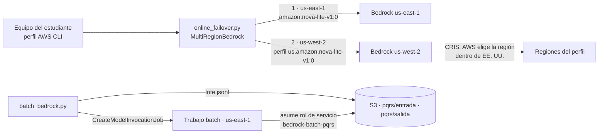

# AWS-E · Topologías en AWS: Cross-Region inference, conmutación y batch

> **Estado de validación (20-oct-2026):**
> - ✅ Lógica de conmutación y flujo batch probados con **botocore Stubber**, que valida los parámetros contra el modelo del servicio de `boto3==1.43.116` (8 pruebas).
> - ⏳ **No se ha ejecutado contra una cuenta real.** Disponibilidad de modelos por región, cuotas y tiempos de cola deben validarse antes de la clase.
> - ⚠️ El **plan Free** de AWS indica que «las funciones multirregión o entre regiones no están soportadas para ningún servicio» ([servicios admitidos](https://docs.aws.amazon.com/accounts/latest/reference/supported-services-sign-up-new.html)). Los perfiles de inferencia entre regiones (`us.`, `global.`) pueden fallar en ese plan. Como en la Sesión 1, se recomienda el plan Paid con AWS Budgets.

## 1. Objetivo y competencias

- Distinguir la **conmutación gestionada por AWS** (Cross-Region inference) de la **conmutación propia** entre regiones.
- Elegir la **clase de servicio** por solicitud (Standard, Flex, Priority) según el SLO.
- Ejecutar el lote PQRS con **Bedrock batch inference** y un rol de servicio de mínimo privilegio.

## 2. Arquitectura



| Hecho documentado (20-oct-2026) | Consecuencia | Fuente |
| --- | --- | --- |
| Perfiles **geográficos** (`us.`, `eu.`, `jp.`, `au.`) procesan dentro de la geografía; el perfil **global** (`global.`) usa cualquier región comercial. CRIS no cambia dónde se almacenan datos, logs ni configuraciones | CRIS es multi-región gestionada; su alcance es una decisión de residencia | [Securing CRIS](https://aws.amazon.com/blogs/machine-learning/securing-amazon-bedrock-cross-region-inference-geographic-and-global/) |
| Las políticas IAM y SCP deben permitir el perfil y el modelo en **todas** las regiones de destino | Una SCP que limita regiones puede romper CRIS | Misma fuente |
| Niveles de servicio **Reserved, Priority, Standard (default) y Flex**, elegibles por solicitud con `service_tier`; la cuota on-demand se comparte entre priority, default y flex | La clase de servicio es una palanca de costo y latencia por solicitud | [Service tiers](https://docs.aws.amazon.com/bedrock/latest/userguide/service-tiers-inference.html) |
| Batch: 50 % de ahorro frente a on-demand, ventana de 24 h | Lotes nocturnos a mitad de precio | [Capacity, limits and cost optimization](https://docs.aws.amazon.com/bedrock/latest/userguide/capacity-limits-cost-optimization.html) |
| Mínimo de **100 registros** por trabajo (valor fijo en las cuotas de los modelos listados); Nova Lite admite batch en una sola región en us-east-1 | El lote de prueba debe tener 100 registros o más | [Cuotas de Bedrock](https://docs.aws.amazon.com/general/latest/gr/bedrock.html) · [Modelos con batch](https://docs.aws.amazon.com/bedrock/latest/userguide/batch-inference-supported.html) |

## 3. Prerrequisitos

- Cuenta de AWS de la Sesión 1 con AWS Budgets configurado.
- AWS CLI con un perfil de credenciales temporales (por ejemplo, `aws configure sso`). No use claves de acceso de larga duración.
- Acceso al modelo Amazon Nova Lite en us-east-1 y us-west-2 (consola de Bedrock).
- Permisos para crear un bucket S3 y un rol IAM.

## 4. Requerimientos de hardware y software

Python 3.12 y AWS CLI v2. Sin GPU.

## 5. Configuración del entorno

```bash
cd labs/31-aws-topologias
python3.12 -m venv .venv && source .venv/bin/activate
pip install -r requirements-dev.txt
pytest -q                      # 8 pruebas sin red
cp .env.example .env
```

## 6. Procedimiento

### AWS-E.1 · Consola: perfiles de inferencia y niveles de servicio (10 min)

1. En la consola de Bedrock, abra **Cross-region inference** y localice los perfiles de Nova Lite. Anote las regiones de destino del perfil `us.`.
2. Abra la ficha del modelo y revise qué niveles de servicio admite (Priority, Flex).
3. Discuta: ¿qué perfil usaría si los datos solo pueden procesarse en EE. UU.?

### AWS-E.2 · Código: conmutación entre regiones (15 min)

```bash
python online_failover.py "¿Hasta cuándo puedo solicitar una homologación?"
python online_failover.py "hola" --repeticiones 10
```

Puntos de análisis en `multiregion_aws.py`:

- `retries={"max_attempts": 1}` en botocore: sin reintentos internos, la conmutación es inmediata.
- Se conmuta ante `ThrottlingException`, `ServiceUnavailableException`, `InternalServerException`, `ModelNotReadyException`, `ModelTimeoutException` y errores de conexión.
- `ValidationException` y `AccessDeniedException` no conmutan: fallarían igual en otra región.

### AWS-E.3 · Simular la caída de la primaria (5 min)

Cambie la región del primer destino por una sin acceso a Bedrock o un `model_id` que no exista en esa región, y observe la diferencia:

- Región inalcanzable → error de conexión → conmutación.
- Modelo inexistente → `ValidationException` o `ResourceNotFoundException` → **sin** conmutación (error de configuración).

### AWS-E.4 · Clases de servicio (10 min, opcional)

```bash
python online_failover.py "hola" --repeticiones 5 --service-tier flex
python online_failover.py "hola" --repeticiones 5 --service-tier priority
```

La respuesta incluye el nivel que efectivamente atendió (`tier=`). Si el modelo no admite el nivel, Bedrock devuelve un error de validación. Compare latencias y consulte la diferencia de precio en la [página de precios](https://aws.amazon.com/bedrock/pricing/).

### AWS-E.5 · Batch desde la consola (20 min)

1. Cree el bucket y el rol de servicio:

```bash
./iam/crear_rol.sh llm-curso-<usuario>-batch us-east-1
# Copie AWS_BATCH_ROLE_ARN a .env
python batch_bedrock.py preparar --n 200
```

2. En la consola de Bedrock, abra **Batch inference** y cree un trabajo: modelo Nova Lite, entrada `s3://<bucket>/pqrs/entrada/`, salida `s3://<bucket>/pqrs/salida/` y el rol `bedrock-batch-pqrs`.
3. Observe los estados: `Submitted → Validating → Scheduled → InProgress → Completed`.

### AWS-E.6 · Batch desde el código (10 min + espera)

```bash
python batch_bedrock.py enviar
python batch_bedrock.py estado --esperar
python batch_bedrock.py descargar
python ../01-local-gateway/scripts/evaluar_lote.py --resultados data/salida_bedrock.jsonl --etiquetas data/etiquetas.jsonl
```

El archivo `manifest.json.out` resume registros procesados, errores y tokens de entrada y salida: es la base para calcular el costo real del lote.

### AWS-E.7 · Arquitectura de referencia (taller)

Complete la topología multi-región de AWS del taller. Considere el backend en ECS o Lambda en dos regiones con Route 53 (registros con health checks y failover), el perfil CRIS adecuado a la residencia, el lote nocturno con EventBridge Scheduler y la ubicación del agente de AgentCore de la Sesión 1.

## 7. Resultados esperados

| Paso | Resultado |
| --- | --- |
| AWS-E.2 | Respuesta desde us-east-1, 1 intento |
| AWS-E.3 | Conmutación solo en el caso de región inalcanzable |
| AWS-E.6 | Estado `Completed`, 200 registros en `salida_bedrock.jsonl` y manifiesto con conteo de tokens |

## 8. Pruebas de validación

`pytest -q` cubre: primaria sana con los parámetros exactos de Converse, conmutación ante tres errores reintentables y ante error de conexión, ausencia de conmutación ante `ValidationException`, `serviceTier` en la solicitud y la respuesta, falla de todas las regiones, mínimo de 100 registros, parámetros de `CreateModelInvocationJob` (incluidos `modelInvocationType=Converse`, rol, S3 y etiquetas) y descarga de resultados y manifiesto.

## 9. Seguridad y permisos mínimos

- Credenciales temporales del perfil de AWS CLI; ninguna clave en el repositorio.
- El rol `bedrock-batch-pqrs` solo puede ser asumido por Bedrock **desde su cuenta** (`aws:SourceAccount`) y para trabajos batch (`aws:SourceArn`). Sus permisos se limitan al prefijo `pqrs/` del bucket del laboratorio.
- Bucket con bloqueo de acceso público y etiqueta `curso=llm-infra`.
- Para usar un perfil CRIS en batch, el rol necesita además `bedrock:InvokeModel` sobre el perfil y sobre el modelo en cada región de destino (plantilla oficial en la guía del rol de servicio).

## 10. Costos

Tokens del lote al precio batch (50 % de ahorro según la guía de costos de Bedrock) más almacenamiento S3 mínimo. Las pruebas online consumen pocos miles de tokens. Precios vigentes en la [página oficial](https://aws.amazon.com/bedrock/pricing/); este laboratorio no fija cifras.

## 11. Solución de problemas

| Síntoma | Causa probable | Acción |
| --- | --- | --- |
| `AccessDeniedException` en Converse | Sin acceso al modelo o plan Free con perfil entre regiones | Habilite el modelo; use el plan Paid o un `model_id` de una sola región |
| `ValidationException` al crear el trabajo | Menos de 100 registros, rol incorrecto o modelo sin batch en la región | Revise el lote, el ARN del rol y la tabla de modelos con batch |
| El trabajo falla al leer S3 | El rol no puede acceder al prefijo o el bucket está en otra región | Revise `permissions-policy.json` y la región del bucket |
| `descargar` no encuentra `.jsonl.out` | El trabajo no ha terminado | `python batch_bedrock.py estado --esperar` |

## 12. Limpieza

```bash
python batch_bedrock.py cancelar                          # si quedó en curso
aws s3 rm s3://llm-curso-<usuario>-batch --recursive
aws s3api delete-bucket --bucket llm-curso-<usuario>-batch
aws iam delete-role-policy --role-name bedrock-batch-pqrs --policy-name s3-lote-pqrs
aws iam delete-role --role-name bedrock-batch-pqrs
```

## 13. Preguntas de reflexión

1. ¿Qué falla cubre CRIS y cuál cubre la conmutación propia? ¿Tiene sentido combinarlas?
2. Para el lote nocturno de PQRS, compare batch con el nivel Flex: plazo, mínimo de registros, operación y precio.
3. Si una SCP de la universidad solo permite us-east-1, ¿qué pasa con el perfil `us.` y cómo lo detectaría antes de producción?
