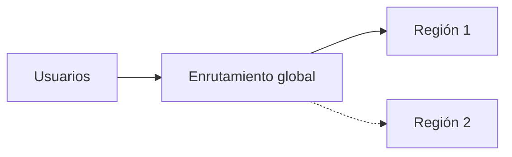

# Plantilla · Diseño preliminar de topología

**Equipo:** · **Caso:** A / B / C · **Nube principal:** · **Fecha:**

## 1. Supuestos

| # | Supuesto | Fuente o justificación |
| --- | --- | --- |
| S1 | | |

## 2. Cargas de trabajo

| Carga | Patrón (online / asíncrona / batch) | SLI | SLO |
| --- | --- | --- | --- |
| | | | |

## 3. Objetivos de continuidad

| Carga | Disponibilidad | RTO | RPO | Justificación |
| --- | --- | --- | --- | --- |
| | | | | |

## 4. Datos y residencia

| Dato | Clasificación | Dónde puede procesarse | Dónde se almacena |
| --- | --- | --- | --- |
| | | | |

## 5. Topología

Diagrama (Mermaid o imagen) con regiones, zonas, enrutamiento global, gateway, modelos, datos replicados y camino batch.

Estrategia de recuperación elegida (backup and restore, pilot light, warm standby, activo-activo) y por qué:

Disponibilidad compuesta estimada (mostrar el cálculo):

## 6. Servicios y modalidades

| Componente | Servicio | Tipo de despliegue o endpoint | Modalidad de consumo | Justificación |
| --- | --- | --- | --- | --- |
| | | | | |

## 7. Resiliencia

| Patrón | Dónde se aplica | Parámetros |
| --- | --- | --- |
| Timeout | | |
| Reintentos | | |
| Circuit breaker | | |
| Degradación | | |

## 8. Riesgos y controles

| Riesgo | Categoría (incluya al menos uno de OWASP LLM 2025) | Control |
| --- | --- | --- |
| | | |

## 9. Costo estimado

| Elemento | Supuesto de volumen | Precio usado (fuente y fecha) o variable | Costo mensual |
| --- | --- | --- | --- |
| | | | |

## 10. ADR

- **Título:**
- **Contexto:**
- **Decisión:**
- **Alternativas consideradas:**
- **Consecuencias:**
