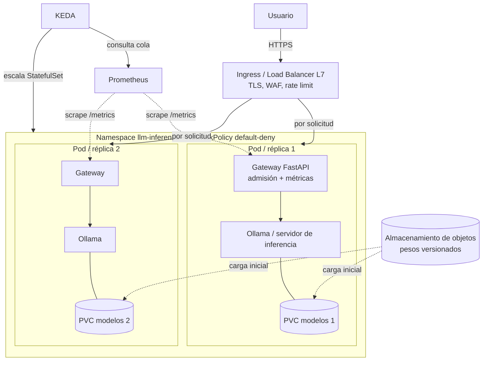

# Arquitectura de referencia — Sesión 4: Redes, Almacenamiento y Autoscaling en inferencia

> Convención de este documento (Principio 5 del proyecto): **[Hecho]** = documentado en fuente oficial citada;
> **[Supuesto]** = hipótesis académica del caso; **[Recomendación]** = criterio de diseño argumentado.
> Revisión de fuentes: 2026-11-03. Ningún valor numérico de rendimiento proviene de mediciones reales realizadas por los autores.

## 1. Caso transversal y requisitos
Asistente institucional de conocimiento para una universidad. **[Supuesto]** 5 000 usuarios potenciales, 100 concurrentes,
disponibilidad objetivo 99,9 % (≈ 43 min de indisponibilidad por mes de 30 días), acceso autenticado, datos protegidos, presupuesto limitado.

| ID | Requisito no funcional | Implicación en esta sesión |
|---|---|---|
| RNF-1 | 99,9 % disponibilidad | ≥ 2 réplicas en dominios de falla distintos; probes; PDB; N+1 |
| RNF-2 | 100 concurrentes | Dimensionar por tokens/s y cola, no por usuarios registrados |
| RNF-3 | Latencia fluida | SLO supuesto: TTFT p95 < 2 s; ≥ 10–15 tok/s por usuario |
| RNF-4 | Datos protegidos | Red privada, egress controlado, cifrado, sin claves estáticas |
| RNF-5 | Presupuesto | Escalar por demanda real; min/max réplicas; FinOps |

## 2. Vista general (implementación del repositorio)

## 3. Redes
### 3.1 Por qué el balanceo clásico falla con LLM
Una solicitud HTTP tradicional dura milisegundos y su costo es casi homogéneo. Una generación de LLM dura segundos o minutos,
su costo depende de la longitud de salida (desconocida de antemano) y mantiene una conexión abierta con *streaming*.
Consecuencias: (1) *round-robin* reparte **conexiones**, no **trabajo**, y puede apilar generaciones largas en una réplica;
(2) un balanceador L4 con conexiones persistentes (HTTP/1.1 keep-alive o HTTP/2) fija a un cliente a una réplica;
(3) *timeouts* por defecto de proxys/balanceadores (p. ej. ocioso de 60 s) cortan generaciones largas; (4) el *buffering* del proxy rompe SSE.

| Estrategia | Reparte según | Ventaja | Límite en LLM |
|---|---|---|---|
| Round-robin | turno | simple | ignora el costo de cada generación |
| Least-connections | conexiones activas | mejor que RR | una conexión ≠ una unidad de trabajo |
| EWMA / latencia | latencia reciente | reacciona a réplicas lentas | señal retrasada |
| **Consciente del modelo** | cola, uso de KV cache, prefijo | equilibra el trabajo real | requiere métricas del servidor de inferencia y un *endpoint picker* |

**[Hecho]** GKE Inference Gateway enruta según métricas como uso de KV cache, utilización del acelerador y longitud de cola, y soporta
enrutamiento por prefijo-caché; se apoya en la extensión de inferencia de Gateway API (código abierto, `kubernetes-sigs/gateway-api-inference-extension`).
**[Recomendación]** En esta sesión se usa Ingress L7 con `ewma` + control de admisión en el gateway; en producción a escala evaluar un balanceador consciente del modelo.

### 3.2 Segmentación y Zero Trust de red
- **Denegar por defecto** (NetworkPolicy `default-deny-all`) y abrir solo: Ingress controller → gateway:8000; Prometheus → gateway:8000; DNS; egress mínimo.
- El servidor de inferencia **no escucha fuera del Pod** (`OLLAMA_HOST=127.0.0.1`): no hay superficie de red que proteger.
- **Egress**: los modelos no deben descargarse de Internet en producción; usar almacenamiento de objetos privado con *private endpoint*
  (Azure Private Endpoint, AWS PrivateLink/Gateway endpoint, GCP Private Service Connect). NetworkPolicy no filtra por FQDN: usar firewall/proxy con *allowlist* si hace falta.
- Bloquear el endpoint de metadatos de la nube (169.254.169.254) para pods de aplicación (mitiga robo de credenciales por SSRF).
- TLS extremo a extremo hacia el usuario; mTLS interno si hay malla de servicios.

### 3.3 Equivalentes por proveedor (orientación conceptual)
| Función | Azure | AWS | GCP |
|---|---|---|---|
| L7 público | Application Gateway / Front Door | Application Load Balancer | Cloud Load Balancing (Gateway) |
| Balanceo consciente de inferencia | (verificar oferta vigente) | (verificar oferta vigente) | GKE Inference Gateway |
| Conectividad privada | Private Endpoint | PrivateLink | Private Service Connect |
| Políticas de red en K8s | Azure CNI + NetworkPolicy / Cilium | VPC CNI + NetworkPolicy | GKE Dataplane V2 |
Verifique nombres y características en la documentación vigente: cambian con frecuencia.

## 4. Almacenamiento
### 4.1 Tamaño de los pesos (aritmética, no medición)
`bytes ≈ parámetros × bytes_por_parámetro`. Un modelo de 8 000 M de parámetros: FP16 (2 B) ≈ 16 GB; INT4 (≈ 0,5 B) ≈ 4–5 GB (más metadatos).
Los pesos deben caber en VRAM **junto con** el KV cache y activaciones: por eso la cuantización y el recorte del contexto son decisiones de capacidad.

### 4.2 Tipos de almacenamiento y su rol
| Tipo | Rol | Ventaja | Riesgo |
|---|---|---|---|
| Objetos (S3, Blob, GCS) | Fuente de verdad versionada de pesos y artefactos | Durable, barato, cifrado, políticas | Latencia/ancho de banda de descarga → *cold start* |
| Bloque (EBS, Managed Disk, PD) | Volumen por réplica (RWO) | Baja latencia | Atado a una zona y a un Pod a la vez |
| Archivos compartidos (EFS, Azure Files, Filestore) | Caché compartida (RWX) | Una copia para N réplicas | Throughput variable, costo, bloqueos |
| NVMe local / efímero | Caché rápida de pesos | Máxima velocidad | Se pierde con el nodo |

### 4.3 *Cold start* de una réplica nueva (el tiempo que más importa al autoscaling)
`T_listo = T_nodo + T_imagen + T_descarga_pesos + T_carga_VRAM + T_calentamiento`
Mitigaciones: pre-calentar nodos (*overprovisioning*), imágenes sin pesos y pequeñas, caché local de pesos, descarga paralela/streaming,
réplica mínima ≥ 1 (no escalar a cero para tráfico interactivo). **[Recomendación]** Pesos **fuera** de la imagen: cambian a otro ritmo y multiplican el tamaño.
### 4.4 Gestión
Versionado y checksums de pesos (cadena de suministro), cifrado en reposo con claves gestionadas por el cliente cuando aplique,
política de ciclo de vida, y trazabilidad de qué versión sirve cada réplica. En Kubernetes con réplicas: **un PVC por réplica** (`StatefulSet.volumeClaimTemplates`) o RWX compartido.

## 5. Autoscaling
### 5.1 Señales (de peor a mejor para LLM)
1. CPU/memoria — en inferencia sobre CPU se satura con 1 solicitud; en GPU casi no refleja la cola.
2. Utilización de GPU — alta incluso con carga eficiente; no distingue «ocupada bien» de «saturada».
3. **Profundidad de cola** — demanda insatisfecha; es la señal de este laboratorio (`llm_gateway_queue_depth`).
4. Uso de KV cache y TTFT/latencia — presión de memoria y síntoma percibido por el usuario (útil como *guardrail*).
**[Hecho]** AWS documenta en EKS el autoscaling de inferencia con HPA + KEDA usando profundidad de cola y p95 de latencia end-to-end como disparadores.

### 5.2 Ley de Little y dimensionamiento
`L = λ · W` (L: solicitudes en el sistema, λ: tasa de llegada, W: tiempo en el sistema). **[Supuesto]** Con 100 usuarios concurrentes y generaciones de 20 s,
λ ≈ 5 solicitudes/s si cada usuario encadena solicitudes sin pausa. Si cada réplica sostiene `c` generaciones concurrentes,
réplicas ≥ L / (c · ρ_objetivo). La utilización objetivo ρ **no** puede acercarse a 1: la espera en cola crece de forma no lineal
(curva de «palo de hockey»), y la cola infinita convierte un pico en indisponibilidad. De ahí el *margen* (`headroom`) y el rechazo explícito.
### 5.3 Horizontal, vertical y de clúster
| Tipo | Qué cambia | En inferencia LLM |
|---|---|---|
| Horizontal (HPA/KEDA) | Nº de réplicas | Principal mecanismo; limitado por *cold start* y cuota de GPU |
| Vertical (VPA, ajuste de requests) | CPU/RAM por Pod | Útil para dimensionar el gateway y el CPU del servidor; **no** cambia VRAM de una GPU física; suele requerir reinicio del Pod |
| De clúster/nodos (Cluster Autoscaler, Karpenter, aprovisionamiento automático) | Nº de nodos GPU | Añade minutos al camino crítico; requiere cuota |
Anti-*flapping*: ventana de estabilización larga para bajar, política rápida para subir (ver `k8s/50-keda-scaledobject.yaml`).
### 5.4 Escalar a cero
Ahorra costo en cargas esporádicas o por lotes; para un asistente interactivo introduce un *cold start* de minutos en la primera solicitud. **[Recomendación]** `minReplicaCount: 1` en el caso universitario.

## 6. Planificación de GPU (GPU scheduling)
| Mecanismo | Idea | Aislamiento | Notas |
|---|---|---|---|
| Device plugin (`nvidia.com/gpu`) | Recurso entero, exclusivo | Total | Declarativo y simple; sin atributos ni compartición fina |
| Time-slicing | Turnos sobre una GPU | **Sin aislamiento de memoria** | Mejora ocupación; riesgo de interferencia |
| MIG (hardware compatible) | Particiones físicas con memoria y cómputo dedicados | Fuerte | Disponible solo en GPU compatibles; tamaños fijos |
| MPS | Comparte cómputo entre procesos | Parcial | Requiere configuración |
| **DRA** (`resource.k8s.io/v1`) | Reclamos declarativos: `DeviceClass`, `ResourceClaim`, selectores CEL | Según el driver | **[Hecho]** APIs núcleo GA desde Kubernetes 1.34; NVIDIA donó su driver DRA a la comunidad (KubeCon EU, mar-2026). No mezclar con device plugin en el mismo nodo |
Control de colocación: `nodeSelector`/afinidad, *taints*/*tolerations* en pools GPU, topologías (NVLink) para paralelismo tensorial, y evitar fragmentación (muchas GPU parcialmente usadas).
Cargas **en línea** → capacidad dedicada o reservada; cargas **por lotes/evaluación** → *spot/preemptible* y colas (Kueue/gang scheduling).

## 7. Seguridad aplicada a esta sesión
| Riesgo | Control en el repositorio |
|---|---|
| OWASP LLM10:2025 *Unbounded Consumption* | Cola acotada, `max_tokens` ≤ 2048, timeouts, 429/503, métricas de rechazo |
| Exposición del servidor de inferencia | Escucha en loopback, red `internal`, NetworkPolicy |
| Credenciales | Sin claves estáticas: Entra ID / IAM / ADC; `GW_API_KEY` solo para el laboratorio |
| SSRF → robo de credenciales | Egress sin acceso a 169.254.169.254 |
| Cadena de suministro de modelos | Pesos desde fuente controlada, versionados y verificados (checksum) |
| Prompt injection / herramientas | Validación de entrada en la frontera LLM→función (herramientas de los laboratorios) |
| Registro | No se registran prompts completos en logs; métricas sin contenido |
Marcos: OWASP Top 10 for LLM Applications 2025, NIST AI RMF 1.0 y Perfil de IA Generativa NIST AI 600-1, ISO/IEC 42001:2023, ISO/IEC 27001:2022.
**Verifique si existe una versión más reciente de OWASP LLM Top 10 antes de citarla en clase.**

## 8. FinOps de la inferencia autogestionada
`costo_por_1M_tokens = (costo_GPU_hora / (tokens_por_segundo_sostenidos × 3600 × utilización)) × 10⁶`.
La **utilización** es la palanca: una GPU ociosa cobra igual. Compare siempre contra la tarifa por token de la API administrada **con sus propios números**
(el repositorio no incluye precios: cambian y varían por región). Variables: tokens/s medidos, utilización real, costo de GPU reservada vs bajo demanda vs spot, costo de ingeniería/operación, requisitos de privacidad.

## 9. Observabilidad y SLOs
SLIs: TTFT, TPOT, latencia e2e, tasa de rechazo, disponibilidad (ver `monitoring/slo-rules.yaml`).
**[Supuesto]** SLO académico: TTFT p95 < 2 s; 99,9 % de solicitudes no rechazadas por error del sistema. Cuantas más réplicas, más importante la cola de cola (*tail latency*): Dean & Barroso, *The Tail at Scale*.
