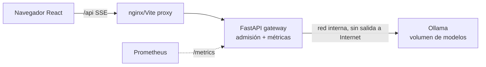

# Laboratorio 0 — Inferencia local con Ollama + FastAPI + React (Ubuntu 24.04)

## 1. Objetivo y competencias
Ejecutar un LLM local, exponerlo a través de un *gateway* con **cola acotada y métricas**, y observar con datos propios cómo
la concurrencia, la cola y el rechazo (429/503) determinan la latencia. Es la base empírica de la teoría de autoscaling.

## 2. Arquitectura


## 3. Requisitos
- Ubuntu 24.04+; Docker + Compose plugin; ≥ 8 GB RAM libres para el modelo pequeño (`llama3.2:1b`) — sin GPU funciona, más lento.
- Opcional GPU NVIDIA: driver + NVIDIA Container Toolkit (ver `docs/guia-gpu.md` del repositorio docente).
- Python 3.12 y Node 22 solo si ejecuta sin Docker.

## 4. Opción A — Docker Compose (recomendada)
```bash
cp .env.example .env
docker compose up -d --build ollama gateway web
docker compose --profile setup run --rm model-pull        # descarga el modelo al volumen (con Internet)
curl -s localhost:8000/readyz                              # {"ready":true,...} cuando el modelo está en el volumen
curl -s localhost:8000/v1/chat -H 'Content-Type: application/json' \
  -d '{"messages":[{"role":"user","content":"Hola"}],"max_tokens":32}'
# UI: http://localhost:8080
```

## 5. Opción B — Instalación nativa de Ollama
```bash
curl -fsSL https://ollama.com/install.sh | sh        # revise el script antes de ejecutarlo en producción
ollama pull llama3.2:1b && ollama run llama3.2:1b "Hola"
python3.12 -m venv .venv && source .venv/bin/activate && pip install -r requirements-dev.txt
cd backend && uvicorn app.main:app --port 8000
cd ../frontend && npm install && npm run dev            # http://localhost:5173
```

## 6. Experimentos guiados (entregue sus tablas)
1. **Línea base:** `python loadtest/loadtest.py --concurrency 1 --requests 10`.
2. **Barrido:** `--concurrency 1,2,4,8,16 --requests 32`. Grafique tokens/s y p95 de latencia vs concurrencia. ¿Dónde se «dobla» la curva?
3. **Saturación:** con `GW_MAX_QUEUE=2`, lance concurrencia 16: ¿cuántos 429? ¿cómo cambia p95?
4. **Cola vs CPU:** durante el barrido observe `curl -s localhost:8000/metrics | grep -E 'queue_depth|in_flight'` y `htop`.
   ¿Qué señal anticipa mejor la degradación?
5. **Volúmenes:** `docker compose down` y `up` de nuevo: ¿se vuelve a descargar el modelo? ¿por qué?

## 7. Validación automatizada
`pytest backend` (11 pruebas con un Ollama simulado, sin red ni GPU) y `pytest labs/common`.
**Los resultados de rendimiento dependen de su hardware: registre los suyos; el repositorio no incluye cifras de referencia.**

## 8. Seguridad
Ollama no publica puertos y vive en una red `internal`; el gateway valida entradas y puede exigir `GW_API_KEY`;
imagen del gateway sin root. Para exponer fuera de localhost agregue TLS y autenticación real.

## 9. Costos
Local: sin costo cloud. Consumo de energía/CPU del equipo.

## 10. Solución de problemas
| Síntoma | Acción |
|---|---|
| `/readyz` 503 | Modelo no descargado: ejecute `model-pull`; revise `GW_MODEL` |
| 502 | `docker compose logs ollama` (memoria insuficiente → modelo más pequeño) |
| Streaming «a golpes» | Proxy con *buffering*: use `proxy_buffering off` (ya en `nginx.conf`) |
| Muy lento | CPU-only es esperable; baje `max_tokens` o use GPU |

## 11. Limpieza
`docker compose down -v` (borra el volumen del modelo) y `docker image prune`.

## 12. Preguntas de reflexión
1. ¿Por qué la latencia p95 explota cuando la concurrencia supera `OLLAMA_NUM_PARALLEL`?
2. ¿Por qué el gateway devuelve 429 en lugar de encolar sin límite?
3. ¿Qué pasaría con réplicas múltiples si los pesos viajaran dentro de la imagen del contenedor?
