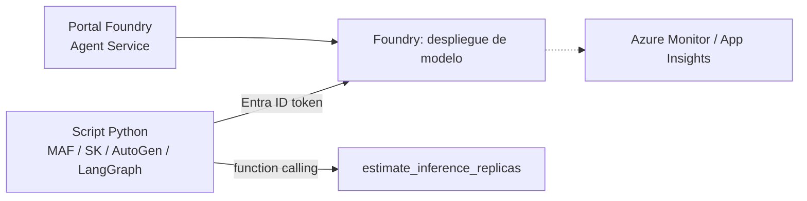

# Laboratorio 2 — Azure: agente en Microsoft Foundry + 4 frameworks de código

> **Estado de validación (2026-11-03):** se verificó que los cuatro scripts **importan y construyen** sus objetos con las
> dependencias de `requirements-*.txt` (LangGraph compila el grafo; Agent Framework expone `Agent(..., tools=...)`).
> **No se ejecutaron llamadas reales a un modelo en Azure.** El docente debe correr el laboratorio una vez antes de la sesión.

## 1. Objetivo y competencias
Construir el mismo agente de dimensionamiento con (a) el portal de Foundry y (b) cuatro frameworks, y **decidir con criterios**
cuál adoptar. Competencias: autenticación Entra ID sin claves, function calling, comparación de modelos de programación.

## 2. Estado de los frameworks (verificado en fuentes públicas, nov-2026)
| Framework | Estado | Recomendación |
|---|---|---|
| **Microsoft Agent Framework** | GA 1.0 desde abr-2026 (Python y .NET), MIT; sucesor de SK y AutoGen | **Primera opción** para proyectos nuevos en Azure |
| **Semantic Kernel** | Modo mantenimiento; MS dirige a Agent Framework | Solo si ya existe base instalada; ver guía de migración |
| **AutoGen** | Modo mantenimiento; sucesor: Agent Framework | Valor didáctico (patrones multiagente); no para nuevos productos |
| **LangGraph** | Independiente del proveedor (LangChain); corre sobre modelos Azure | Cuando se requiere control explícito de grafos/estado o portabilidad multicloud |

## 3. Arquitectura


## 4. Prerrequisitos y hardware
Suscripción Azure (prueba gratuita; **no** actualice a pago por uso si no desea cargos), Azure CLI, Python 3.12, Ubuntu 24.04+.
Rol mínimo sobre el proyecto/cuenta: *Foundry User* (antes *Azure AI User*) para invocar; *Foundry Project Manager* solo para crear agentes hospedados.
Sin GPU local.

## 5. Parte A — Agente desde el portal de Foundry
1. En el portal de Foundry cree un **proyecto** (región con cuota para el modelo elegido).
2. **Model catalog → Deploy**: despliegue un modelo de chat con *function calling*. Anote el **nombre del despliegue**.
3. **Build → Agents → Create agent** (nombre `capacity-advisor-portal`), seleccione el despliegue, pegue `INSTRUCTIONS` de `azure_config.py`.
4. Abra el **Playground** y haga la pregunta de `QUESTION`. Compare con los scripts: ¿mismo resultado? ¿quién calcula, el LLM o una herramienta?
5. Registre en su informe qué herramientas ofrece el portal (búsqueda, archivos, MCP, etc.) y qué le falta frente al código.

## 6. Parte B — Cuatro implementaciones en código
Cada framework en **su propio entorno virtual** (sus dependencias entran en conflicto entre sí):
```bash
cd labs/02-azure-foundry
cp .env.example .env && nano .env          # endpoints y NOMBRE del despliegue
az login
for fw in maf sk autogen langgraph; do python3.12 -m venv .venv-$fw && .venv-$fw/bin/pip install -r requirements-$fw.txt; done
.venv-maf/bin/python maf_agent.py
.venv-sk/bin/python sk_agent.py
.venv-autogen/bin/python autogen_agent.py
.venv-langgraph/bin/python langgraph_agent.py
```
**Resultado esperado:** los cuatro invocan la herramienta y responden 6 réplicas base / 7 con N+1.

## 7. Pruebas de validación y métrica de comparación
- Misma pregunta en los cuatro; registre: líneas de código, número de llamadas al LLM, tiempo e2e, facilidad para depurar.
- Pregunta incompleta (sin `replica_tps`): ¿el agente pregunta o inventa?
- Complete la matriz de `docs/comparacion-frameworks.md` con **sus** mediciones (no copie valores de terceros).

## 8. Seguridad y permisos mínimos
Entra ID (`DefaultAzureCredential`; en Azure use identidad administrada), sin claves; RBAC mínimo; red privada
(Private Endpoint) y desactivar acceso público en producción; filtros de contenido de Foundry; no registrar prompts sensibles.

## 9. Costos
Tokens del modelo + (si aplica) hospedaje del agente. Use la calculadora de precios de Azure con su región/modelo;
configure un presupuesto con alerta en *Cost Management*.

## 10. Solución de problemas
| Síntoma | Causa | Acción |
|---|---|---|
| `DeploymentNotFound` | Se usó el nombre del modelo, no del despliegue | Use el nombre del despliegue |
| `401/403` | Falta rol o `az login` caducado | Asigne *Foundry User*; repita `az login` |
| `ModuleNotFoundError` | Entorno virtual equivocado | Use el venv del framework |
| Versión de API no soportada | `AZURE_OPENAI_API_VERSION` antigua | Consulte la documentación vigente de su recurso |

## 11. Limpieza
Elimine el **grupo de recursos** del laboratorio (`az group delete -n <rg> --yes --no-wait`) y verifique en Cost Management.

## 12. Preguntas de reflexión
1. ¿Por qué Microsoft consolidó SK y AutoGen? ¿Qué riesgo de *lock-in* y de deuda técnica implica elegir cada uno?
2. ¿Cuándo justifica LangGraph su complejidad frente a Agent Framework?
3. ¿Qué cambia en red y seguridad al pasar de la prueba gratuita a producción con Private Endpoints?
