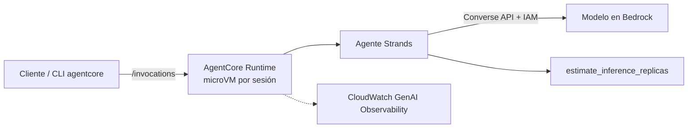

# Laboratorio 3 — AWS: agente en Bedrock (consola), Strands Agents y AgentCore Runtime

> **Estado de validación (2026-11-03):** se verificó que `strands_agent.py` construye el agente con su herramienta y que
> `agentcore_app.py` importa y registra el *entrypoint* con `bedrock-agentcore`. **No se invocó ningún modelo ni se desplegó en AWS.**
> Amazon Bedrock AgentCore es GA desde oct-2025 y se amplió a más regiones en 2026; **verifique su región** en la tabla oficial
> (las funciones individuales varían por región). El docente debe ejecutar el laboratorio una vez antes de la sesión.

## 1. Objetivo y competencias
Crear un agente (a) en la consola de Bedrock (gestionado), (b) con Strands Agents SDK (código) y (c) desplegarlo en
AgentCore Runtime (serverless). Comparar niveles de gestión y aislamiento.

## 2. Arquitectura


## 3. Prerrequisitos y hardware
Cuenta AWS (nivel gratuito/créditos), AWS CLI v2 con SSO, Python 3.12, Ubuntu 24.04+. Para pruebas locales de contenedor: Docker (opcional).
Permisos mínimos: `bedrock:InvokeModel*` sobre el modelo elegido; para Parte A, gestión de agentes de Bedrock; para despliegue,
los permisos de AgentCore del *Developer Guide* (rol de ejecución del runtime con el mínimo necesario). Evite `AdministratorAccess`.

## 4. Parte A — Agente en la consola de Bedrock
1. **Model catalog**: solicite/confirme acceso a un modelo de texto con soporte de herramientas; copie su **ID o perfil de inferencia**.
2. **Agents → Create agent** (`capacity-advisor-console`) → seleccione el modelo → instrucciones = `SYSTEM_PROMPT` de `aws_config.py`.
3. **Guardar y *Prepare***; pruebe en el panel de test. Cree un **alias** (versión inmutable) y copie `agentId` y `agentAliasId`.
4. (Opcional) Agregue un *Action group* con una función Lambda; compare el esfuerzo con una herramienta `@tool`.
5. Invoque por código: `python invoke_console_agent.py` (requiere `BEDROCK_AGENT_ID` y `BEDROCK_AGENT_ALIAS_ID`).

## 5. Parte B — Strands Agents SDK
```bash
cd labs/03-aws-bedrock
python3.12 -m venv .venv && source .venv/bin/activate && pip install -r requirements.txt
cp .env.example .env && nano .env            # BEDROCK_MODEL_ID y AWS_REGION
aws sso login
python strands_agent.py
```

## 6. Parte C — Despliegue en AgentCore Runtime
```bash
python agentcore_app.py &                     # prueba local en :8080
curl -s localhost:8080/invocations -H 'Content-Type: application/json' -d '{"prompt":"100 usuarios, 15 tok/s, 400 tok/s por réplica"}'
kill %1
agentcore configure --entrypoint agentcore_app.py     # asistente: rol, región, ECR
agentcore launch                                       # compila y despliega
agentcore invoke '{"prompt": "Tengo 100 usuarios concurrentes, 15 tok/s por usuario y 400 tok/s por réplica"}'
```
Los comandos provienen de la documentación de Strands/AgentCore revisada el 2026-11-03; la CLI evoluciona: use `agentcore --help`.

## 7. Pruebas de validación
`pytest labs/common`; pregunta incompleta (¿pregunta por `replica_tps`?); `{"prompt": ""}` → respuesta de error controlada;
invocación concurrente de dos sesiones para observar aislamiento por sesión.

## 8. Seguridad
IAM por rol (sin claves), mínimo privilegio sobre el modelo, secretos fuera del repositorio, AgentCore Identity/Policy para
controlar herramientas, Bedrock Guardrails para contenido/PII, logs sin datos sensibles.

## 9. Costos
Tokens del modelo + AgentCore (consumo) + ECR/CloudWatch. Consulte la página de precios oficial de su región; cree un presupuesto en AWS Budgets antes de empezar.

## 10. Solución de problemas
| Síntoma | Causa | Acción |
|---|---|---|
| `AccessDeniedException` | Modelo no habilitado o rol sin permiso | Habilite el modelo; revise la política |
| `ValidationException` model id | ID incorrecto/no disponible en la región | Use un perfil de inferencia de su región |
| `agentcore launch` falla | Docker/ECR/rol | Revise permisos y la salida; use `agentcore --help` |
| Servicio no disponible en la región | Cobertura regional | Consulte la tabla oficial y cambie de región |

## 11. Limpieza
Elimine el runtime de AgentCore (consola o CLI), el repositorio ECR, el rol IAM creado, el agente de Bedrock y sus alias,
y los grupos de logs de CloudWatch. Verifique en *Cost Explorer*.

## 12. Preguntas de reflexión
1. ¿Qué garantiza el aislamiento por microVM frente a un contenedor compartido? ¿Qué amenazas mitiga (fuga de contexto entre usuarios)?
2. ¿Cuándo elegiría Bedrock Agents (gestionado) frente a Strands + AgentCore?
3. ¿Cómo se refleja el *modelo de responsabilidad compartida* en cada nivel?
