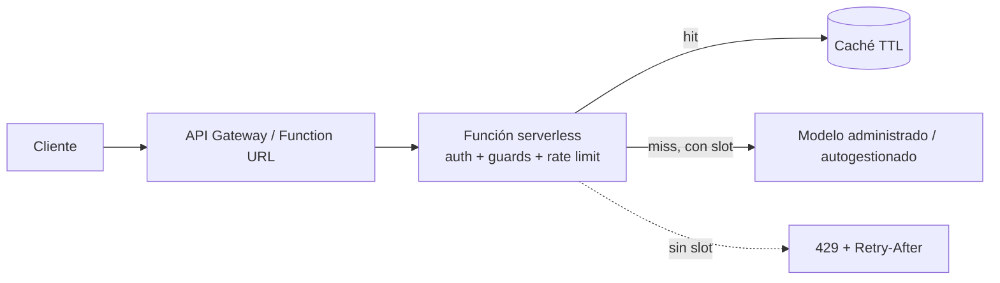
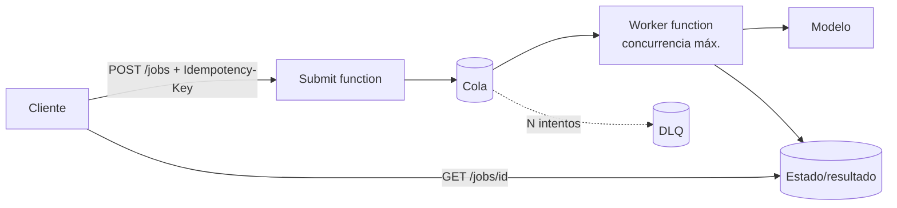
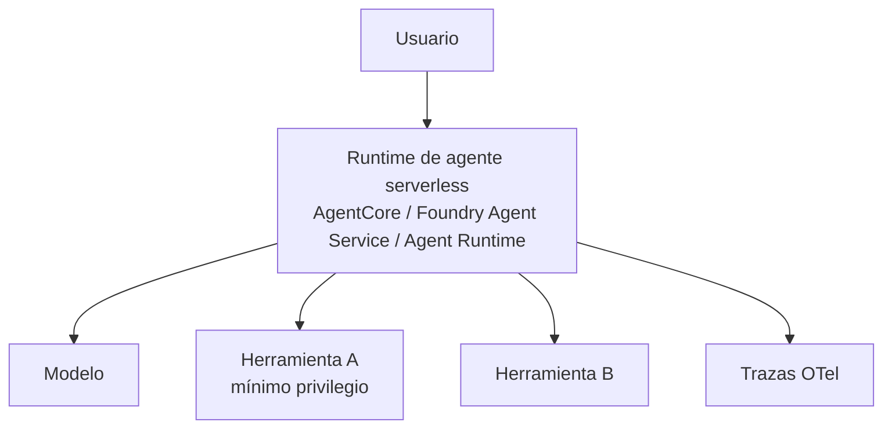

# Arquitecturas de referencia

## A1. Síncrona con caché y backpressure

## A2. Asíncrona con cola (orquestación de inferencia)

## A3. Agente serverless

Patrones aplicados: Queue-Based Load Leveling, Competing Consumers, Retry+DLQ, Idempotent Receiver, Cache-Aside, Bulkhead (semáforo), Circuit Breaker (extensión sugerida), Claim Check para payloads grandes.
